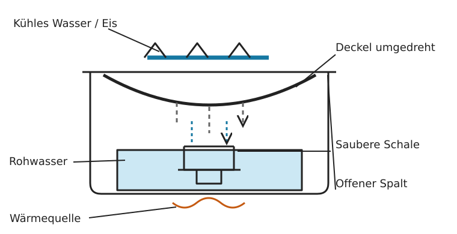

# Wasser destillieren – improvisierte Anlage aus Haushaltsmitteln

!!! warning "Notverfahren, kein universeller Trinkwassernachweis"
    Destillation trennt viele Krankheitserreger, Salze, Metalle und **viele nichtflüchtige** Schadstoffe vom aufgefangenen Kondensat. **Flüchtige Chemikalien können mit übergehen.** Bei Benzin-, Lösungsmittel-, Industriechemikalien- oder unbekanntem Chemikalienverdacht **andere Quelle wählen**. Ein improvisierter Aufbau garantiert keine Trinkwasserqualität.

## Prinzip

**Verdampfen → Dampf abkühlen → Kondensat getrennt auffangen.** Anders als beim [Abkochen und Vorfiltern](regenwasser-pfuetzen-improvisierte-filter.md) wird nicht das ursprüngliche Wasser getrunken, sondern der aufgefangene Wasserdampf nach dem Kondensieren. Rohwasser und Kondensat dürfen sich nicht vermischen.

## Variante A: Topf und Auffangschale – ohne Bohren oder Spezialteile

**Skizze (von außen nach innen):** Großer Topf mit wenig Rohwasser; darin eine **erhöht stehende, leere hitzefeste Schale**; darüber ein **umgedrehter, gekühlter Deckel**. Aufsteigender Dampf kondensiert an der Deckelunterseite und tropft in die Schale. Die Schale steht **oberhalb des Rohwasserspiegels**.

**Material:** Großer Kochtopf, passender umdrehbarer Deckel (möglichst mit nach unten gerichteter tiefster Stelle), kleine hitzefeste Schale, stabiler hitzefester Untersetzer, Wärmequelle, möglichst kaltes Wasser oder Eis zum Kühlen des Deckels. Saubere, geeignete Materialien für Lebensmittelkontakt verwenden.

1. **Rohwasser vorbereiten:** Grobe Partikel absetzen lassen und durch ein sauberes Tuch vorfiltern. Bei Verdacht auf flüchtige Chemikalien **nicht beginnen**.
2. **Schale erhöhen:** Untersetzer und leere Auffangschale standsicher in den Topf stellen. Rohwasser außen herum einfüllen, **deutlich unterhalb des Schalenrandes**. Nichts darf umkippen.
3. **Deckel umdrehen:** So auflegen, dass sein tiefster Punkt über der Auffangschale liegt. **Nicht luftdicht abdichten**; der Aufbau muss jederzeit drucklos bleiben. Achtung: Nicht jeder Deckel lässt sich sicher umdrehen.
4. **Langsam erhitzen:** Sanft sieden lassen; starkes Sprudeln und Spritzen vermeiden. Deckel von oben vorsichtig mit kaltem Wasser oder Eis kühlen, sofern die Deckelkonstruktion das sicher zulässt. Kein kaltes Wasser auf heißes, bruchempfindliches Glas geben.
5. **Kondensat entnehmen:** Wärmequelle ausschalten, abkühlen lassen, Deckel vorsichtig abheben. Nur Wasser aus der **inneren Schale** verwenden, sofern Rohwasser weder hineingespritzt noch hineingelaufen ist. Hygienisch verschlossen lagern.

**Nachteile:** Langsam, geringer Ertrag, hoher Energieverbrauch. Das Nachfüllen von Rohwasser oder Entnehmen der Schale im heißen Zustand birgt Verbrühungsgefahr. Läuft Kühlwasser vom Deckel in die Schale, ist das Kondensat verunreinigt.

## Variante B: Kondensationsrohr – nur mit geeigneten Bauteilen

Ein für Lebensmittel-/Trinkwasserkontakt geeignetes Metallrohr kann Dampf aus einem Topf in einen **abwärts geneigten, von außen gekühlten** Abschnitt und anschließend in ein sauberes Auffanggefäß leiten. Das ist technisch aufwendiger als Variante A: Deckelanschluss, Rohr und Kühlung müssen mechanisch sicher sein. **Der Dampfauslass bleibt offen; keine Absperrung, kein Druckaufbau.** Unbekannte Schläuche, bleihaltige Lote, ungeeignete Klebstoffe und gebrauchte Chemikalienleitungen sind tabu. Ohne geeignete Teile Variante A bevorzugen.

## Was trennt Destillation – und was nicht?

| Verunreinigung | Bewertung |
| --- | --- |
| Bakterien, Viren, Parasiten | Bei korrekt betriebenem Aufbau überwiegend vom Kondensat getrennt; Spritzwasser und spätere Verkeimung vermeiden |
| Salze, viele Schwermetalle | Bleiben als nichtflüchtige Stoffe überwiegend im Rohwasser |
| Schwebstoffe, Sand, Schlamm | Bleiben normalerweise im Topf; Spritzer und Schaum vermeiden |
| Viele Cyanotoxine | Als überwiegend nichtflüchtige Stoffe grundsätzlich abtrennbar; **kein Sicherheitsnachweis bei unbekannter Belastung** |
| Benzin, Lösungsmittel, manche Pestizide und andere flüchtige Stoffe | **Nicht zuverlässig entfernt**, können mitverdampfen oder übergehen |
| Flüchtige Gase und Stoffe, Aerosole | Können ins Kondensat gelangen; auch der Aufbau selbst kann Verunreinigungen eintragen |

**Merksatz:** **Abkochen** dient primär der Keimreduktion; **Destillieren** trennt zusätzlich viele nichtflüchtige Stoffe ab. **Keines von beiden macht jede unbekannte Wasserquelle sicher.**

## Entscheidung: Wann einsetzen?

- **Sichere Wasserquelle oder Vorrat verfügbar?** Diese bevorzugen.
- **Nur mikrobiologische Belastung plausibel, keine Chemikalienhinweise?** [Vorfiltern und Abkochen](regenwasser-pfuetzen-improvisierte-filter.md) ist meist einfacher und energiesparender.
- **Salzhaltiges Wasser oder nichtflüchtige gelöste Stoffe?** Destillation kann sinnvoll sein, sofern keine gefährlichen flüchtigen Beimengungen zu vermuten sind.
- **Algenblüte / Cyanotoxinverdacht?** Andere Quelle bevorzugen. Destillation kann viele nichtflüchtige Cyanotoxine abtrennen, **aber improvisiert ohne Kontrolle keine Trinkwasserfreigabe**.
- **Unbekannte Chemikalien, Kraftstoff, Hochwasser oder Industrieeinträge?** **Nicht** auf improvisierte Destillation verlassen; andere Quelle suchen.

## Weiterführende Kapitel

- [Wasserbedarf und Trink-/Brauchwasser unterscheiden](wasserbedarf-pro-person.md)
- [Regenwasser, Pfützen und improvisierte Vorfilter](regenwasser-pfuetzen-improvisierte-filter.md)
- [Oberflächenwasser aufbereiten und Material beschaffen](oberflaechenwasser-aufbereiten.md)

## Quellen und redaktioneller Stand

- [CDC: Making Water Safe in an Emergency](https://www.cdc.gov/water-emergency/about/)
- [CDC: Water Treatment When Hiking, Camping, or Traveling](https://www.cdc.gov/drinking-water/prevention/water-treatment-hiking-camping-traveling.html)

**Status:** Redaktioneller Entwurf, fachlicher Review ausstehend. Die SVG ist eine **Prinzip-Skizze**, kein geprüfter Gerätebauplan.
