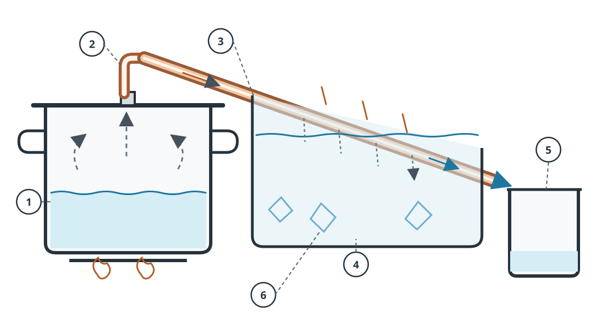

# Wasser destillieren – improvisierte Anlage aus Haushaltsmitteln

!!! warning "Notverfahren, kein universeller Trinkwassernachweis"
    Destillation trennt viele Krankheitserreger, Salze, Metalle und **viele nichtflüchtige** Schadstoffe vom aufgefangenen Kondensat. **Flüchtige Chemikalien können mit übergehen.** Bei Benzin-, Lösungsmittel-, Industriechemikalien- oder unbekanntem Chemikalienverdacht **andere Quelle wählen**. Ein improvisierter Aufbau garantiert keine Trinkwasserqualität.

## Prinzip

**Verdampfen → Dampf abkühlen → Kondensat getrennt auffangen.** Anders als beim [Abkochen und Vorfiltern](regenwasser-pfuetzen-improvisierte-filter.md) wird nicht das ursprüngliche Wasser getrunken, sondern der aufgefangene Wasserdampf nach dem Kondensieren. Rohwasser und Kondensat dürfen sich nicht vermischen.

## Variante A: Topf und Auffangschale – ohne Bohren oder Spezialteile

**Legende zur Schnittzeichnung:** 1 Rohwasser (blau, außen im Topf); 2 kaltes Wasser oder Eis auf dem umgedrehten Metalldeckel; 3 offener Randspalt als Druckausgleich, niemals abdichten; 4 erhöhte hitzefeste Auffangschale (Destillat); 5 Wärmequelle; 6 aufsteigender Dampf (gestrichelte Pfeile). Die blauen Tropfen zeigen das Kondensat, das in die Schale fällt. **Der Schalenrand muss oberhalb des Rohwasserspiegels liegen.**

**Funktionsweise:** Dampf steigt aus dem Rohwasser auf, kondensiert an der kühleren Deckelunterseite und läuft zum tiefsten Punkt. Dort tropft er in die separate Auffangschale. Der offene Randspalt verhindert Druckaufbau.

**Material:** Großer Kochtopf, passender umdrehbarer Deckel (möglichst mit nach unten gerichteter tiefster Stelle), kleine hitzefeste Schale, stabiler hitzefester Untersetzer, Wärmequelle, möglichst kaltes Wasser oder Eis zum Kühlen des Deckels. Saubere, geeignete Materialien für Lebensmittelkontakt verwenden.

1. **Rohwasser vorbereiten:** Grobe Partikel absetzen lassen und durch ein sauberes Tuch vorfiltern. Bei Verdacht auf flüchtige Chemikalien **nicht beginnen**.
2. **Schale erhöhen:** Untersetzer und leere Auffangschale standsicher in den Topf stellen. Rohwasser außen herum einfüllen, **deutlich unterhalb des Schalenrandes**. Nichts darf umkippen.
3. **Deckel umdrehen:** So auflegen, dass sein tiefster Punkt über der Auffangschale liegt. **Nicht luftdicht abdichten**; der Aufbau muss jederzeit drucklos bleiben. Achtung: Nicht jeder Deckel lässt sich sicher umdrehen.
4. **Langsam erhitzen:** Sanft sieden lassen; starkes Sprudeln und Spritzen vermeiden. Deckel von oben vorsichtig mit kaltem Wasser oder Eis kühlen, sofern die Deckelkonstruktion das sicher zulässt. Kein kaltes Wasser auf heißes, bruchempfindliches Glas geben.
5. **Kondensat entnehmen:** Wärmequelle ausschalten, abkühlen lassen, Deckel vorsichtig abheben. Nur Wasser aus der **inneren Schale** verwenden, sofern Rohwasser weder hineingespritzt noch hineingelaufen ist. Hygienisch verschlossen lagern.

**Nachteile:** Langsam, geringer Ertrag, hoher Energieverbrauch. Das Nachfüllen von Rohwasser oder Entnehmen der Schale im heißen Zustand birgt Verbrühungsgefahr. Läuft Kühlwasser vom Deckel in die Schale, ist das Kondensat verunreinigt.

## Variante B: Topf mit gekühltem Kondensationsrohr

**Legende:** 1 Topf mit Rohwasser; 2 Dampfanschluss im Deckel; 3 durchgehendes, leicht abwärts geneigtes Metallrohr; 4 Kühlwanne, die das Rohr von außen umspült; 5 sauberes Auffanggefäß unter dem **offenen** Rohrende; 6 Kühlwasser, bei Bedarf mit Eis.

**Prinzip:** Dampf gelangt aus dem erhitzten Topf ins Metallrohr, kühlt im Wasserbad ab und kondensiert. Das Gefälle führt das Kondensat in ein separates Gefäß. Kühlwasser und Kondensat dürfen sich nicht mischen.

**Material:** Kochtopf mit Metalldeckel, geeignete hitzebeständige Rohrdurchführung, sauberes für Trinkwasserkontakt geeignetes Metallrohr (z. B. Edelstahl oder geeignetes Kupfer), Kühlwanne, kaltes Wasser und sauberes Auffanggefäß. Gebrauchte Leitungen unbekannter Herkunft, bleihaltiges Lot, ungeeignete Schläuche und Klebstoffe nicht verwenden.

**Aufbau und Betrieb:**

1. **Quelle beurteilen:** Bei Verdacht auf Kraftstoffe, Lösungsmittel oder unbekannte Industriechemikalien andere Wasserquelle suchen. Grobe Partikel vorab absetzen lassen.
2. **Dampfweg anordnen:** Einen geeigneten Rohranschluss am Deckel vorsehen. Das Rohr mit gleichmäßigem Gefälle durch das Kühlbad bis über das Auffanggefäß führen; Senken und Knicke vermeiden, in denen Kondensat den Durchgang blockieren könnte.
3. **Kühlung aufbauen:** Das Rohr im kalten Wasser fixieren, aber seinen Auslass außerhalb des Kühlwassers und **frei offen** halten. Warm gewordenes Kühlwasser ersetzen.
4. **Vorsichtig erhitzen:** Nur sanft sieden lassen und ständig beaufsichtigen. Wenn kein Dampf beziehungsweise Kondensat austritt, ungewöhnlicher Druck entsteht oder ein Anschluss undicht wird, Wärmequelle ausschalten und abkühlen lassen.
5. **Getrennt auffangen:** Kondensat in einem sauberen Gefäß sammeln und vor erneuter Verunreinigung schützen. Bei Rohwasserspritzern oder Kühlwassereintrag verwerfen.

!!! danger "Kein Druckkessel"
    **Nie den Rohrauslass verschließen oder ein Ventil einbauen.** Ein verstopftes Rohr kann Überdruck erzeugen. Der heiße Dampf und das Metallrohr können schwere Verbrühungen verursachen. Der gezeichnete Aufbau ist eine Prinzipskizze und kein geprüfter Gerätebauplan.

**Vergleich:** Variante A benötigt weniger Spezialteile, liefert aber meist nur kleine Mengen. Variante B lässt sich besser kühlen und kontinuierlicher auffangen, setzt jedoch geeignete Rohrteile und sichere Verbindungen voraus. Beide Varianten haben dieselben [Grenzen bei der Wasserqualität](#was-trennt-destillation-und-was-nicht).

## Was trennt Destillation – und was nicht?

| Verunreinigung | Bewertung |
| --- | --- |
| Bakterien, Viren, Parasiten | Bei korrekt betriebenem Aufbau überwiegend vom Kondensat getrennt; Spritzwasser und spätere Verkeimung vermeiden |
| Salze, viele Schwermetalle | Bleiben als nichtflüchtige Stoffe überwiegend im Rohwasser |
| Schwebstoffe, Sand, Schlamm | Bleiben normalerweise im Topf; Spritzer und Schaum vermeiden |
| Viele Cyanotoxine | Als überwiegend nichtflüchtige Stoffe grundsätzlich abtrennbar; **kein Sicherheitsnachweis bei unbekannter Belastung** |
| Benzin, Lösungsmittel, manche Pestizide und andere flüchtige Stoffe | **Nicht zuverlässig entfernt**, können mitverdampfen oder übergehen |
| Flüchtige Gase und Stoffe, Aerosole | Können ins Kondensat gelangen; auch der Aufbau selbst kann Verunreinigungen eintragen |

**Merksatz:** **Abkochen** dient primär der Keimreduktion; **Destillieren** trennt zusätzlich viele nichtflüchtige Stoffe ab. **Keines von beiden macht jede unbekannte Wasserquelle sicher.**

## Entscheidung: Wann einsetzen?

- **Sichere Wasserquelle oder Vorrat verfügbar?** Diese bevorzugen.
- **Nur mikrobiologische Belastung plausibel, keine Chemikalienhinweise?** [Vorfiltern und Abkochen](regenwasser-pfuetzen-improvisierte-filter.md) ist meist einfacher und energiesparender.
- **Salzhaltiges Wasser oder nichtflüchtige gelöste Stoffe?** Destillation kann sinnvoll sein, sofern keine gefährlichen flüchtigen Beimengungen zu vermuten sind.
- **Algenblüte / Cyanotoxinverdacht?** Andere Quelle bevorzugen. Destillation kann viele nichtflüchtige Cyanotoxine abtrennen, **aber improvisiert ohne Kontrolle keine Trinkwasserfreigabe**.
- **Unbekannte Chemikalien, Kraftstoff, Hochwasser oder Industrieeinträge?** **Nicht** auf improvisierte Destillation verlassen; andere Quelle suchen.

## Weiterführende Kapitel

- [Wasserbedarf und Trink-/Brauchwasser unterscheiden](wasserbedarf-pro-person.md)
- [Regenwasser, Pfützen und improvisierte Vorfilter](regenwasser-pfuetzen-improvisierte-filter.md)
- [Oberflächenwasser aufbereiten und Material beschaffen](oberflaechenwasser-aufbereiten.md)

## Quellen und redaktioneller Stand

- [CDC: Making Water Safe in an Emergency](https://www.cdc.gov/water-emergency/about/)
- [CDC: Water Treatment When Hiking, Camping, or Traveling](https://www.cdc.gov/drinking-water/prevention/water-treatment-hiking-camping-traveling.html)

**Status:** Redaktioneller Entwurf, fachlicher Review ausstehend. Die SVG ist eine **Prinzip-Skizze**, kein geprüfter Gerätebauplan.
