# Winkeralphabet (Flaggensemaphore)

!!! info "Status: Quellenbasierter Entwurf"
    Die 26 Buchstaben sowie das Zahlen- und Annullierungszeichen wurden anhand der [Semaphore-Referenz der Australian National Botanic Gardens](https://www.anbg.gov.au/flags/semaphore.html) in einer einheitlichen Empfängeransicht neu gezeichnet. Eine praktische Prüfung mit zwei Personen steht aus. Stand: 26.10.2026.

## Kurzüberblick

Mit **Flaggensemaphore** (Winkeralphabet) lassen sich Buchstaben durch die **Stellung zweier ausgestreckter Arme** übermitteln. Die Flaggen machen die Armstellung auf Entfernung besser erkennbar. Benötigt werden freie Sicht, ausreichendes Licht und ein Empfänger, der die Zeichen kennt. Funknetz, Strom und Mobilfunk werden dafür nicht gebraucht.

**Verwechslungsgefahr:** Das [Morsealphabet](morsealphabet.md) überträgt zeitliche Folgen kurzer und langer Signale mit Licht, Ton oder Funk. Semaphore überträgt eine **gleichzeitig gehaltene Stellung beider Arme**. Maritime Signalflaggen, die an Masten gehisst werden, sind nochmals ein anderes System.

## Blickrichtung und Uhrstellungen

**Alle Abbildungen zeigen die sendende Person von vorn.** Ihr **linker Arm** erscheint für den Betrachter **rechts im Bild**, ihr **rechter Arm** links im Bild. Die Wörter „links“ und „rechts“ in den Tabellen und im Decoder bezeichnen ausnahmslos **die Arme der sendenden Person**.

Arme und Flaggen können in acht Richtungen stehen. Aus Sicht des Empfängers werden diese wie die Zeigerpositionen einer Uhr um den Körper gelesen:

| Uhrstellung | Richtung im Bild |
| --- | --- |
| 12 Uhr | senkrecht nach oben |
| 1:30 Uhr | schräg nach oben rechts |
| 3 Uhr | waagerecht nach rechts |
| 4:30 Uhr | schräg nach unten rechts |
| 6 Uhr | senkrecht nach unten |
| 7:30 Uhr | schräg nach unten links |
| 9 Uhr | waagerecht nach links |
| 10:30 Uhr | schräg nach oben links |

**Wichtig:** Manche Zeichen verlangen, dass ein Arm vor dem Körper zur anderen Seite zeigt. Deshalb im Decoder nie einfach nur die zwei Flaggenpositionen sortieren, sondern **linken und rechten Arm des Senders unterscheiden**. Bei verdeckten oder nicht sicher erkennbaren Armen das Zeichen wiederholen lassen.

## Buchstaben A–Z

Die kleinen SVG-Zeichnungen sind eigenständig editierbare Vektorgrafiken, jeweils **ein Zeichen pro Tabellenzeile**. Rot und Gelb helfen beim Erkennen der Flagge; entscheidend ist die **Armstellung**, nicht die Farbe. Die Uhrstellungen daneben machen jedes Zeichen zusätzlich als Text auffindbar.

| Zeichen | Flaggenstellung (Empfängeransicht) | Linker Arm (Sender) | Rechter Arm (Sender) | Als Ziffer¹ |
| :---: | :---: | :--- | :--- | :---: |
| **A** | 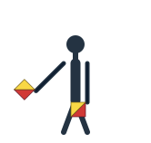{ height="52px" } | 6 Uhr | 7:30 Uhr | 1 |
| **B** | 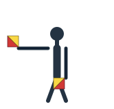{ height="52px" } | 6 Uhr | 9 Uhr | 2 |
| **C** | { height="52px" } | 6 Uhr | 10:30 Uhr | 3 |
| **D** | 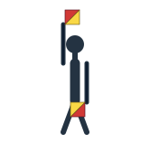{ height="52px" } | 6 Uhr | 12 Uhr | 4 |
| **E** | 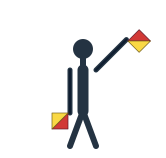{ height="52px" } | 1:30 Uhr | 6 Uhr | 5 |
| **F** | 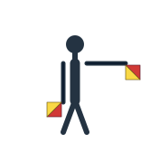{ height="52px" } | 3 Uhr | 6 Uhr | 6 |
| **G** | { height="52px" } | 4:30 Uhr | 6 Uhr | 7 |
| **H** | 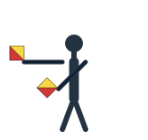{ height="52px" } | 7:30 Uhr | 9 Uhr | 8 |
| **I** | 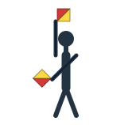{ height="52px" } | 7:30 Uhr | 12 Uhr | 9 |
| **J** | 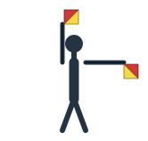{ height="52px" } | 3 Uhr | 12 Uhr | – |
| **K** | 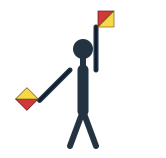{ height="52px" } | 12 Uhr | 7:30 Uhr | 0 |
| **L** | 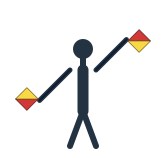{ height="52px" } | 1:30 Uhr | 7:30 Uhr | – |
| **M** | 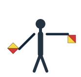{ height="52px" } | 3 Uhr | 7:30 Uhr | – |
| **N** | 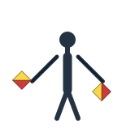{ height="52px" } | 4:30 Uhr | 7:30 Uhr | – |
| **O** | 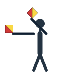{ height="52px" } | 10:30 Uhr | 9 Uhr | – |
| **P** | 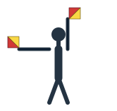{ height="52px" } | 12 Uhr | 9 Uhr | – |
| **Q** | 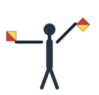{ height="52px" } | 1:30 Uhr | 9 Uhr | – |
| **R** | 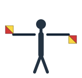{ height="52px" } | 3 Uhr | 9 Uhr | – |
| **S** | 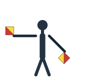{ height="52px" } | 4:30 Uhr | 9 Uhr | – |
| **T** | { height="52px" } | 12 Uhr | 10:30 Uhr | – |
| **U** | { height="52px" } | 1:30 Uhr | 10:30 Uhr | – |
| **V** | 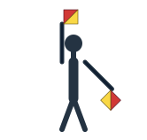{ height="52px" } | 4:30 Uhr | 12 Uhr | – |
| **W** | 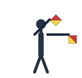{ height="52px" } | 3 Uhr | 1:30 Uhr | – |
| **X** | 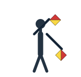{ height="52px" } | 4:30 Uhr | 1:30 Uhr | – |
| **Y** | 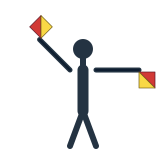{ height="52px" } | 3 Uhr | 10:30 Uhr | – |
| **Z** | 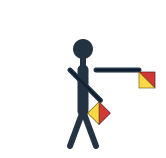{ height="52px" } | 3 Uhr | 4:30 Uhr | – |

¹ **Ziffernmodus:** Erst das Zahlenzeichen zeigen. Dann stehen die Stellungen A bis I für 1 bis 9 und K für 0. Die Stellung von J schaltet wieder auf Buchstaben um. Ohne vorangehendes Zahlenzeichen bleiben es Buchstaben.

## Einen Buchstaben entschlüsseln

Wenn du eine Flaggenstellung beobachtest, beginne oben bei **START** im Decoder und gehe in zwei Schritten vor: **(1)** die Uhrstellung des *linken Arms des Senders* auswählen, **(2)** von dort dem beschrifteten Zweig für den *rechten Arm des Senders* folgen. Am Ende steht der Buchstabe oder das Steuerzeichen. Der Graph hat **einen Startpunkt** und deckt alle **26 Buchstaben** sowie zwei statische Steuerzeichen ab.

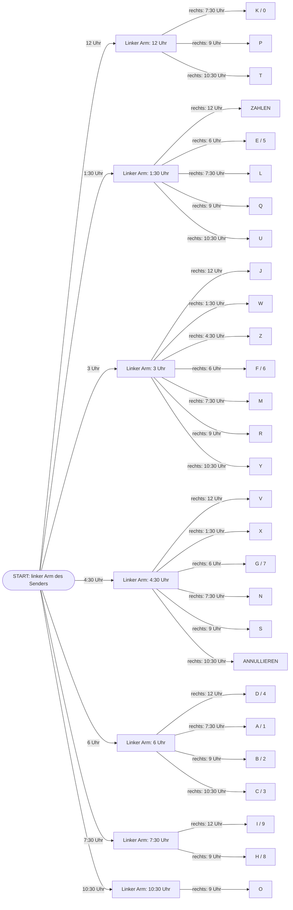

**Beispiel H:** Linker Arm des Senders auf **7:30 Uhr**, rechter Arm auf **9 Uhr**. Im Diagramm führt START → linker Arm 7:30 Uhr → rechter Arm 9 Uhr zum Zeichen **H**. **Beispiel K:** Linker Arm 12 Uhr, rechter Arm 7:30 Uhr ergibt **K** beziehungsweise im Zahlenmodus **0**. Es ist nicht dasselbe wie **I** (linker Arm 7:30 Uhr, rechter Arm 12 Uhr).

## Zahlen und Steuerzeichen

| Zeichen | Stellung (Empfängeransicht) | Linker Arm (Sender) | Rechter Arm (Sender) | Bedeutung |
| :--- | :---: | :--- | :--- | :--- |
| **Zahlenzeichen** | 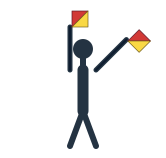{ height="52px" } | 1:30 Uhr | 12 Uhr | Folgende Zeichen als Ziffern lesen |
| **Buchstabenmodus** | { height="52px" } | 3 Uhr | 12 Uhr | Stellung J: von Zahlen zurück zu Buchstaben |
| **Annullieren** | 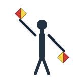{ height="52px" } | 4:30 Uhr | 10:30 Uhr | Voriges Zeichen zurücknehmen; Bedeutung vorher vereinbaren |

Das **Fehlerzeichen** ist kein weiteres festes Winkelpaar: Beide Arme beziehungsweise Flaggen werden gemeinsam mehrfach angehoben und abgesenkt. Ohne beobachtete Bewegung ist dieses Zeichen nicht sicher zu bestimmen.

**Zahlenbeispiel „205“:** Zahlenzeichen → B (= 2) → K (= 0) → E (= 5) → J (zurück zu Buchstaben). Ob nach dem Zahlenblock ein weiterer Steuerabschluss nötig ist, muss dem vereinbarten Übermittlungsverfahren entsprechen. Bei wichtigen Zahlen die gesamte Folge wiederholen lassen.

## Senden und Empfangen: praktische Reihenfolge

1. **Sichtkontakt herstellen.** Eine Person steht gut sichtbar und frontal zum Empfänger. Zwei kontrastreiche Flaggen oder notfalls gut erkennbare Markierungen genügen als Orientierung. Die Arme bleiben für jedes Zeichen gerade und ruhig.
2. **Buchstabe auswählen:** In der Tabelle das gewünschte Zeichen suchen. Die **beiden Armpositionen** einnehmen; nicht einfach die Grafik spiegeln. Ein geübter Partner kann jede Stellung mit dem Decoder nachlesen.
3. **Zeichen trennen:** Nach jeder gehaltenen Stellung erkennbar in eine zuvor vereinbarte neutrale Ruheposition zurückkehren. Zwischen Wörtern längere Pausen oder eine ausdrücklich vereinbarte Trennung verwenden. Dies ist eine **Übungsvereinbarung**, kein weltweit einheitlicher Nachrichtenstandard.
4. **Nachricht bestätigen lassen:** Kurze Angaben übermitteln, besonders Namen, Zahlen, Ortsangaben und Hilferufe wiederholen. Unklare Zeichen nicht raten.
5. **Bei einer akuten Notlage** zuerst zugängliche reguläre Notruf- und Warnwege nutzen. Fällt die Infrastruktur aus, können vereinbarte optische Zeichen ergänzen, sofern bereits jemand in Sichtweite ist.

**Beispiel SOS:** Im Winkeralphabet werden die drei Stellungen **S**, **O**, **S** nacheinander gehalten. Das ist etwas anderes als das [Morse-Notsignal SOS](morsealphabet.md#signalzeiten-und-pausen), bei dem die zeitliche Abfolge entscheidend ist.

## Grenzen und Alternativen

- **Keine freie Sicht oder unklarer Blickwinkel:** Empfang unzuverlässig. Nicht ohne Absprache auf gut Glück signalisieren; bei geeignetem Licht kann [Morse mit einer Lampe](morsealphabet.md) über längere Sichtstrecken leichter erkennbar sein.
- **Dunkelheit, Nebel, Gegenlicht, große Entfernung:** Arme und Flaggenstellungen schwer zu unterscheiden. Erkennbares Anhalten und Bestätigen ist wichtiger als Geschwindigkeit.
- **Mögliche Beobachtung durch Dritte:** Optische Signale sind sichtbar und nicht vertraulich. Keine Standortangaben übermitteln, wenn das zusätzliche Gefahren schafft.
- **Kein Sichtkontakt, aber Funkgeräte:** Abgesprochene [Funk-Zeitfenster](funkzeitfenster-333-regel.md) sind eine Alternative. Solche Verfahren hängen von Reichweite, Energie, synchronisierten Zeiten und einem empfangenden Partner ab.
- **Warnmeldungen:** [Sirenensignale](sirenensignale.md) sind öffentliche Warnzeichen und kein Ersatz für individuelle Buchstabennachrichten. Bei einer Krise gilt zuerst die [Priorisierung der ersten 72 Stunden](../00-grundlagen/erste-72-stunden.md).

## Weiterführende Artikel

- [Morsealphabet und SOS](morsealphabet.md): optische, akustische und Funk-Zeichen ohne zwei Flaggen.
- [Funk-Zeitfenster bei Netz- und Stromausfall](funkzeitfenster-333-regel.md): abgesprochene Verbindungen über Funk.
- [Sirenensignale verstehen](sirenensignale.md): öffentliche Warnung statt individueller Nachrichten.
- [Kommunikation und Information](index.md): weitere Wege für Zeitabgleich, Funkempfang und Warninformationen.

## Quellen

- Australian National Botanic Gardens, [Semaphore Flag Signalling System](https://www.anbg.gov.au/flags/semaphore.html): Zuordnung von 26 Buchstaben, Ziffernmodus, Zahlenzeichen, Annullieren und bewegtem Fehlerzeichen. Maßgebliche Vorlage für die neue SVG-Serie.
- Australian War Memorial, [Flag semaphore](https://www.awm.gov.au/sites/default/files/Independence.pdf): Einordnung als optische Signaltechnik.
- [J-Kit, Semaphore Alphabet](https://jkit.tools/en/tools/semaphore-alphabet): ergänzende tabellarische Übersicht.

**Redaktioneller Status:** Quellenbasiert überarbeiteter Entwurf. Die SVG-Stellungen und der Decoder wurden anhand desselben Zeichenregisters generiert und automatisiert geprüft; praktische Gegenprobe und fachlicher Review stehen noch aus.
