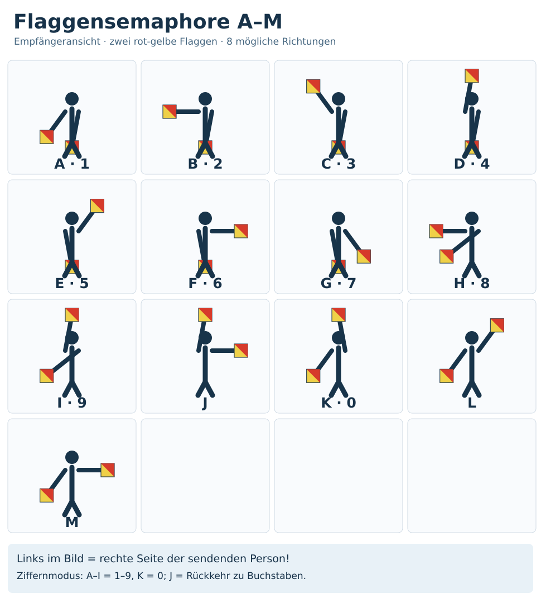
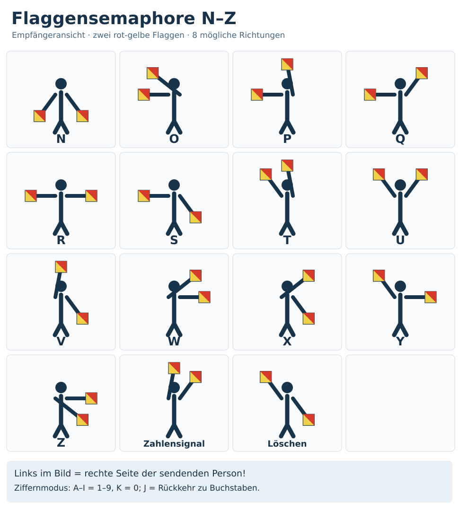

# Flaggenalphabet – Semaphore / Winkeralphabet

!!! info "Status: Quellenbasierter Entwurf"
    Alle 26 Flaggenstellungen wurden gegen die Referenztabelle der Australian National Botanic Gardens kontrolliert. Die SVG-Grafiken wurden eigens konstruiert; der redaktionelle Review steht noch aus. Stand: 25.10.2026.

## Kurzüberblick

Das **Flaggensemaphore** (Winkeralphabet) nutzt zwei ausgestreckte Arme mit je einer gut sichtbaren Flagge. Jede bestimmte Armstellung ergibt einen Buchstaben beziehungsweise ein Steuerzeichen. Damit lassen sich kurze Nachrichten **ohne elektronische Geräte** über Sichtkontakt übermitteln.

Nicht verwechseln: Das **internationale maritime Flaggenalphabet** aus gehissten Signalflaggen ist ein **anderes Verfahren**.

**Blickrichtung:** In den Abbildungen sieht der Empfänger die sendende Person **von vorn**. **Links im Bild ist somit die rechte Seite des Signalgebers.** Beim eigenen Nachstellen ist diese Perspektive zu berücksichtigen. Rot-gelbe, diagonal geteilte Flaggen sind üblich; bei provisorischen Signalen sind zwei andere deutlich sichtbare Fähnchen möglich.

## Flaggenstellungen A–M

{ width=100% }

## Flaggenstellungen N–Z und Sonderzeichen

{ width=100% }

## Jeder Buchstabe mit genauer Winkelstellung

Alle Armrichtungen liegen auf einem Uhrkreis in 45-Grad-Schritten. Die Uhrzeiten bezeichnen **Positionen aus Sicht des gegenüberstehenden Empfängers**. Die Spalten „linker/rechter Arm“ meinen stets den Arm der **sendenden Person** (also nicht links/rechts im Bild). Einige Zeichen erfordern, dass ein Arm vor dem Körper zur anderen Seite geführt wird.

| Buchstabe | Linker Arm (Sender) | Rechter Arm (Sender) | Ziffernmodus |
| --- | --- | --- | --- |
| **A** | 6 Uhr | 7:30 Uhr | 1 |
| **B** | 6 Uhr | 9 Uhr | 2 |
| **C** | 6 Uhr | 10:30 Uhr | 3 |
| **D** | 6 Uhr | 12 Uhr | 4 |
| **E** | 1:30 Uhr | 6 Uhr | 5 |
| **F** | 3 Uhr | 6 Uhr | 6 |
| **G** | 4:30 Uhr | 6 Uhr | 7 |
| **H** | 7:30 Uhr | 9 Uhr | 8 |
| **I** | 7:30 Uhr | 12 Uhr | 9 |
| **J** | 3 Uhr | 12 Uhr | – |
| **K** | 12 Uhr | 7:30 Uhr | 0 |
| **L** | 1:30 Uhr | 7:30 Uhr | – |
| **M** | 3 Uhr | 7:30 Uhr | – |
| **N** | 4:30 Uhr | 7:30 Uhr | – |
| **O** | 10:30 Uhr | 9 Uhr | – |
| **P** | 12 Uhr | 9 Uhr | – |
| **Q** | 1:30 Uhr | 9 Uhr | – |
| **R** | 3 Uhr | 9 Uhr | – |
| **S** | 4:30 Uhr | 9 Uhr | – |
| **T** | 12 Uhr | 10:30 Uhr | – |
| **U** | 1:30 Uhr | 10:30 Uhr | – |
| **V** | 4:30 Uhr | 12 Uhr | – |
| **W** | 3 Uhr | 1:30 Uhr | – |
| **X** | 4:30 Uhr | 1:30 Uhr | – |
| **Y** | 3 Uhr | 10:30 Uhr | – |
| **Z** | 3 Uhr | 4:30 Uhr | – |

## Ziffern und Steuerzeichen

Zum Senden von Zahlen zuerst das **Zahlenzeichen** zeigen (linker Arm **1:30 Uhr**, rechter **12 Uhr**). Dann bedeuten **A–I die Ziffern 1–9** und **K die Null (0)**. Das Zeichen **J** (links **3 Uhr**, rechts **12 Uhr**) signalisiert die Rückkehr zum Buchstabenmodus.

Das **Lösch-/Annullierungszeichen** hat den linken Arm bei **4:30 Uhr** und den rechten bei **10:30 Uhr**. Das **Fehlerzeichen** wird dynamisch gegeben: beide Flaggen gemeinsam wiederholt anheben und senken. Ein einzelnes Foto kann die Bewegung nicht vollständig darstellen.

Die vorherige Entwurfsillustration enthielt doppelte beziehungsweise falsche Flaggenstellungen und eine falsche Ziffernzuordnung. Sie wird deshalb nicht als Referenz eingesetzt.

## Anwendung im Krisenfall

1. Mit zwei kontrastreichen, gut sichtbaren Flaggen in ausreichendem Abstand und gutem Licht zueinander aufstellen.
2. Den Empfänger ansehen und für jeden Buchstaben **beide Arme vollständig ausstrecken**. Die gewünschte Stellung kurz ruhig halten.
3. Zwischen Zeichen eine erkennbare neutrale Position einnehmen und Wortgrenzen bewusst verdeutlichen.
4. Wichtiges nach Möglichkeit durch den Empfänger bestätigen beziehungsweise wiederholen lassen.

**Beispiel:** `SOS` wird durch die Stellungen **S**, **O**, **S** nacheinander gegeben; nicht durch rhythmische Morse-Lichtblitze.

## Grenzen und Sicherheit

- Ohne freie Sicht, etwa hinter Gebäuden oder bei Nebel, funktioniert die Übertragung nicht zuverlässig.
- Dunkelheit, Gegenlicht, große Entfernung, Wind und unsaubere Winkel erhöhen die Fehlerrate.
- Dritte mit Sichtkontakt können Signale ebenfalls lesen. Für akute Notfälle nach Möglichkeit parallel verlässliche Rettungskanäle nutzen.

## Quellen

- Australian National Botanic Gardens (australische Regierung), [Semaphore Flag Signalling System](https://www.anbg.gov.au/flags/semaphore.html), vollständiges Zeichenverzeichnis mit Sonderzeichen (Zugriff: 25.10.2026).
- J-Kit, [Semaphore Alphabet](https://jkit.tools/en/tools/semaphore-alphabet), ergänzende Positionstabelle (Zugriff: 25.10.2026).

**Redaktioneller Status:** Quellenbasierter Entwurf; fachlicher Review ausstehend.
