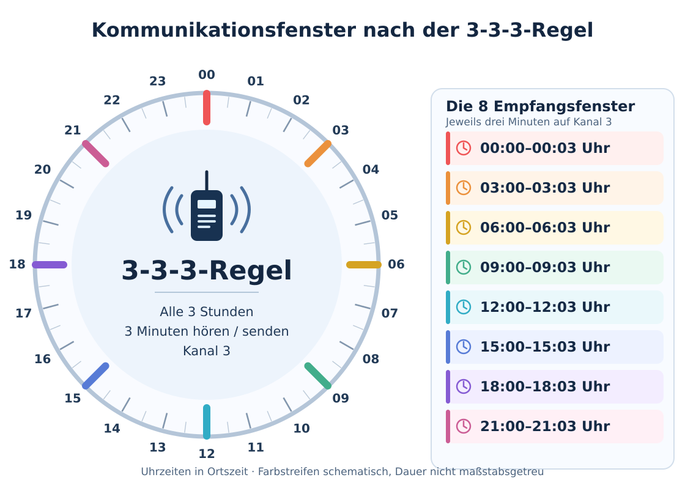

# Funk-Zeitfenster und die 3-3-3-Regel

!!! warning "Quellenbasierter Entwurf – keine amtliche Regel"
    Die **3-3-3-Regel** ist eine **informelle Vereinbarung** aus Bürgernotfunk- und Prepper-Kreisen, keine bundesweit verbindliche Regel des deutschen Katastrophenschutzes. **Kanal 3 wird nicht amtlich und nicht garantiert abgehört.** Stand: 26.10.2026. Fachliche Prüfung steht aus.

## Kurzüberblick

Bei einem langanhaltenden Strom- und Netzausfall müssen Funkgeräte nicht rund um die Uhr eingeschaltet bleiben. Werden Empfangszeiten jedoch nicht abgesprochen, verpassen sich Funkpartner. Die bekannte **3-3-3-Regel** schlägt daher drei Merkpunkte vor:

- **Alle 3 Stunden** zu einem festen Zeitpunkt einschalten.
- **3 Minuten** auf dem vereinbarten Kanal empfangsbereit sein und bei Bedarf kurz rufen.
- **Kanal 3** des *jeweils vorhandenen* analogen Jedermannfunkdienstes als gemeinsamer Treffpunkt.

**Wichtig:** Kanal 3 bedeutet bei PMR446, Freenet und CB-Funk **unterschiedliche Frequenzen**. Geräte unterschiedlicher Funkdienste können daher nicht unmittelbar miteinander sprechen.

## Zeitplan auf einen Blick

{ width=100% }

*Die farbigen Markierungen zeigen die Empfangsfenster schematisch; ihre Breite entspricht nicht der tatsächlichen Dauer von drei Minuten. Die exakten Zeiten stehen in der folgenden Tabelle.*

| Lokalzeit | Hörfenster |
| --- | --- |
| 00:00 | 00:00–00:03 |
| 03:00 | 03:00–03:03 |
| 06:00 | 06:00–06:03 |
| 09:00 | 09:00–09:03 |
| 12:00 | 12:00–12:03 |
| 15:00 | 15:00–15:03 |
| 18:00 | 18:00–18:03 |
| 21:00 | 21:00–21:03 |

Die deutschsprachige 3er-Regel verwendet **Ortszeit**. Bei vorab vereinbarten Gruppenzeiten ausdrücklich Zeitzone und Sommer-/Winterzeit festlegen. Nachts können Mitglieder einer Gruppe vereinbaren, einzelne Termine auszusetzen. Das verringert aber die Kontaktchancen.

## Und wenn keine Uhr mehr funktioniert?

Ein verlässliches 3-Minuten-Funkfenster erfordert ungefähr synchronisierte Uhren. Falls kein Radio vorhanden ist, hilft die Anleitung **[Funkempfang ohne Radio – wiederverwenden oder improvisieren](../05-technologie/radio-ohne-geraet.md)**, einschließlich **RDS-Uhrzeit** und GPS-Zeit. Zum Wiederfinden der Uhrzeit zunächst ein **[hörbares Zeitzeichen im UKW- oder Kurzwellenradio](zeitzeichen-rundfunk.md)** versuchen (in Duisburg z. B. Deutschlandfunk 102,8 MHz), sofern der Rundfunksender noch läuft. Andere Möglichkeiten sind eine **[Sonnenuhr mit geografischer und saisonaler Korrektur](zeitbestimmung-sonne.md)** sowie – mit geeigneter Elektronik – das **[DCF77-Langwellensignal](../05-technologie/dcf77-zeitfunk.md)**. Die Sonnenzeit ist nicht automatisch MEZ/MESZ; ein unkalibrierter Sonnenmittag synchronisiert **keine** drei Minuten kurzen Funkfenster. Ohne verlässliche Uhr nur nach **vorheriger Gruppenabsprache** breitere, relative Zeitfenster nutzen und Zeitabweichung notieren.

## Welcher Kanal ist gemeint?

| Funkdienst | Empfohlener Treffpunkt, **analog** | Frequenz | Besonderheiten |
| --- | --- | --- | --- |
| PMR446 | Kanal 3 | 446,03125 MHz | Kurze lokale Reichweite; nur kompatible PMR446-Geräte |
| Freenet | Kanal 3 | 149,0500 MHz | In Deutschland nutzbarer Jedermannfunk; geeignetes zugelassenes Gerät |
| CB-Funk | Kanal 3, FM | 26,985 MHz | Mit geeigneter Antenne oft größere lokale Reichweite |
| CB-Funk, traditioneller Hilferuf | Kanal 9, vor allem AM | 27,065 MHz | Zusätzlich bekannt; ebenfalls **keine** garantierte Hörbereitschaft |

Diese Kanalzuordnungen sind **Empfehlungen**, keine Reservierung von Frequenzen oder staatlich besetzte Notrufkanäle. Für digitalen PMR446-Funk können Kanalnummern und Betriebsarten abweichen; den analogen Plan nicht ungeprüft übernehmen. Im Amateurfunk gibt es **andere** Anruf- und Notfunk-Aktivitätsfrequenzen, z. B. 145,500 MHz FM oder 3,760 MHz Kurzwelle. Das ist **kein** Ersatz für die 3-3-3-Regel und setzt für den regulären Sendebetrieb die erforderliche Amateurfunkzulassung voraus.

## Vorgehensweise im Krisenfall

1. **Vorher vorbereiten:** Kanal und Betriebsart einprogrammieren bzw. auf einem Papierzettel notieren; Funkpartner und Empfangsreichweite im Alltag testen. Funkgerät und Ersatzenergie bereithalten.
2. **Gemeinsamen Empfang sicherstellen:** Auf PMR446 und Freenet **CTCSS/DCS-Pilotton-Rauschsperre für Empfang deaktivieren** (kein „Privatcode“). Sonst können Signale trotz richtiger Frequenz unhörbar bleiben.
3. **Zum Fenster einschalten:** Möglichst **eine Minute vor der vollen Dreistundenmarke** einschalten; bis nach dem Ende des Fensters zuhören, wenn die Energiereserve das zulässt. Die zusätzliche Minute ist **unsere Praxistoleranz**, nicht Teil des informellen Standards.
4. **Zuerst hören, dann kurz rufen:** Kanalbelegung prüfen. Ein knappes Beispiel: „Hier Station Nord, Standort Stadtteil X, sucht Funkkontakt, bitte kommen.“ Nicht gleichzeitig mit anderen sprechen.
5. **Antworten und bestätigen:** Empfangene Meldungen mit Zeit, Absender, Ort und Inhalt schriftlich festhalten. Wichtige Angaben wiederholen lassen.
6. **Längere Gespräche auslagern:** Nach erfolgreicher Kontaktaufnahme nach Absprache auf einen **anderen zulässigen freien Kanal** wechseln, um Kanal 3 als allgemeinen Treffpunkt möglichst freizuhalten.
7. **Wieder ausschalten oder Stand-by:** Ohne Kontakt nach Ende des Fensters ausschalten, sofern die Sicherheitslage dies zulässt. Bei laufendem Kontakt ein neues Zeitfenster vereinbaren.

## Notfälle haben Vorrang

**Akute Gefahr, schwere Verletzung, Brand oder dringender Hilferuf: nicht drei Stunden abwarten.** Besteht Mobilfunkempfang, regulär **112** (Rettung/Feuerwehr) oder **110** (Polizei) wählen. Sonst sofort auf tatsächlich erreichbaren Funkwegen Hilfe versuchen; andere örtlich bekannte Kanäle und Anlaufstellen einbeziehen. Ein zufällig erreichter Funkteilnehmer ist **keine** Rettungsleitstelle. Notfallverkehr geht vor Routineverkehr.

Für eine verständliche Meldung: **Wer meldet? Wo genau? Was ist passiert? Wie viele Menschen sind betroffen? Welche Hilfe wird gebraucht?** Anschließend auf Rückfragen hören. Empfangene dringliche Hilferufe nicht unnötig blockieren.

## Grenzen, Alternativen und Energiebedarf

- Ohne **vorherige Abmachung**, genügend Reichweite oder synchronisierte Uhren ist die Trefferquote unsicher. Drei Minuten können für mehrere Teilnehmer knapp sein.
- Das Verfahren gilt vor allem für **direkten Sprechfunk**; bei Messenger-Apps mit Zwischenspeicherung, LoRa-/Mesh-Netzen oder automatischen Nachrichtenpuffern gelten andere technische Regeln. Solche Netze nicht pauschal komplett abschalten, wenn sie als Weiterleitungsstation dienen.
- Bei einem Mobiltelefon bedeutet **Ausschalten/Flugmodus**, dass Anrufe und amtliche Mobilfunkwarnungen nicht eintreffen. Energieersparnis gegen Erreichbarkeit abwägen; bei funktionierender Infrastruktur nicht blind abschalten.
- **Behördliche Rundfunkmeldungen** über Batterie-/Kurbelradio unabhängig vom 3-3-3-Funkplan verfolgen, besonders bei akuter Lage. Behörden können jederzeit senden.
- Eine Gruppe kann zusätzliche **lokale, längere** Empfangsfenster vereinbaren, z. B. 10 Minuten um 12 und 18 Uhr. Diese sind **keine überregional anerkannten Termine** und funktionieren nur, wenn alle Beteiligten sie kennen.

**Bei Sichtkontakt ohne Funkgerät:** Zwei weitere Kommunikationswege sind das [Winkeralphabet mit Flaggen](flaggenalphabet.md) und [Morsezeichen mit Licht oder Ton](morsealphabet.md). Beide erfordern einen erreichbaren, eingeweihten Empfänger und ersetzen keine amtlichen Warnmeldungen.

## Quellen

- NOTFUNK-WIKI, [Die 3er-Regel](https://notfunkwiki.de/doku.php?id=betrieb:3er-regel), Zugriff 26.10.2026 (Community-Konvention, inklusive Einwänden und lokalem Zeitplan).
- T-Day, [Channel 3 for Emergency](https://t-day.net/channel-3-for-emergency/), Zugriff 26.10.2026 (informelle Kanal-3-Empfehlung, CTCSS/DCS).
- Prepper-Funk, [T-Day oder die 3er-Regel](https://prepper-funk.com/2022/10/22/t-day-oder-die-3er-regel/), 22.10.2022 (Kritik, Nachbarschaftshilfe statt garantierter BOS-Notrufverbindung).
- International Amateur Radio Union (IARU Region 1), [Emergency Communications Frequencies](https://www.iaru-r1.org/about-us/committees-and-working-groups/emcomm/emergency-communications-frequencies/), Zugriff 26.10.2026 (Amateurfunk-Aktivitätszentren statt landesweiter Bürger-Funkzeiten).
- Notfunk Deutschland e. V., [Notfunkfrequenzen](https://notfunk-deutschland.de/notfunkfrequenzen/), Zugriff 26.10.2026 (keine generelle dauerhafte Überwachung der Aktivitätszentren in Nicht-Gefahrenzeiten).
- Bundesamt für Bevölkerungsschutz und Katastrophenhilfe (BBK), [In der Krise informiert sein](https://www.bbk.bund.de/DE/Warnung-Vorsorge/Vorsorge/In-der-Krise-informiert-sein/in-der-krise-informiert-sein_node.html), Zugriff 26.10.2026 (amtliche Informationen über Radio bei Netzausfall).
- 12db.de, [Notfunk – lizenzfreie Funkdienste](https://www.12db.de/notfunk/), Zugriff 26.10.2026 (Frequenzzuordnungen; Empfehlungen nicht amtlich).

**Status:** Quellenbasierter Entwurf · Fachliche Prüfung ausstehend.
