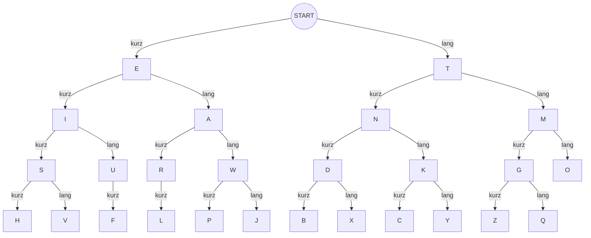

# Morsealphabet – internationaler Morsecode

!!! info "Status: Quellenbasierter Entwurf"
    Zeichen und Zeitregeln nach ITU-R M.1677-1 (2009) dokumentiert. Eine redaktionelle Prüfung steht noch aus (Stand: 25.10.2026).

## Kurzüberblick

Der **internationale Morsecode** stellt Buchstaben und Ziffern durch kurze Signale (**Punkte**) und lange Signale (**Striche**) dar. Er lässt sich durch Lichtblitze, hörbare Töne oder geeigneten Funk übertragen. Dafür sind ein gleichmäßiger Rhythmus und ein erreichbarer Empfänger notwendig.

**Zeichenschlüssel:** Kurzes Signal = Kreis (Punkt), langes Signal = Balken (Strich). Die Tabelle verwendet dafür Vektorgrafiken statt Satzzeichen.

## Buchstaben A–Z

Ein **Kreis** bedeutet kurz, ein **Balken** bedeutet lang. Jedes Signal ist als echte SVG-Form gezeichnet und wird von links nach rechts gelesen.

| Buchstabe | Morsezeichen |
| :---: | :--- |
| **A** | { height="16px" } |
| **B** | { height="16px" } |
| **C** | { height="16px" } |
| **D** | { height="16px" } |
| **E** | { height="16px" } |
| **F** | { height="16px" } |
| **G** | { height="16px" } |
| **H** | { height="16px" } |
| **I** | { height="16px" } |
| **J** | { height="16px" } |
| **K** | { height="16px" } |
| **L** | { height="16px" } |
| **M** | { height="16px" } |
| **N** | { height="16px" } |
| **O** | { height="16px" } |
| **P** | { height="16px" } |
| **Q** | { height="16px" } |
| **R** | { height="16px" } |
| **S** | { height="16px" } |
| **T** | { height="16px" } |
| **U** | { height="16px" } |
| **V** | { height="16px" } |
| **W** | { height="16px" } |
| **X** | { height="16px" } |
| **Y** | { height="16px" } |
| **Z** | { height="16px" } |

## Ziffern 0–9

| Ziffer | Morsezeichen |
| :---: | :--- |
| **0** | { height="16px" } |
| **1** | { height="16px" } |
| **2** | { height="16px" } |
| **3** | { height="16px" } |
| **4** | { height="16px" } |
| **5** | { height="16px" } |
| **6** | { height="16px" } |
| **7** | { height="16px" } |
| **8** | { height="16px" } |
| **9** | { height="16px" } |

## Morsebaum: Buchstaben entschlüsseln

**Finger oben auf START legen.** Für ein kurzes Signal geht es nach **links**, für ein langes Signal nach **rechts**. Nach dem letzten Signal den Buchstaben am erreichten Knoten ablesen. Auch Knoten mit weiteren Ästen sind bereits gültige Buchstaben.

**Beispiel:** kurz (links zu E), lang (rechts zu A), kurz (links zu R) ergibt **R**.

## Signalzeiten und Pausen

| Element | Länge |
| --- | ---: |
| Punkt | 1 Zeiteinheit |
| Strich | 3 Zeiteinheiten |
| Pause zwischen Bestandteilen eines Buchstabens | 1 Zeiteinheit |
| Pause zwischen Buchstaben | 3 Zeiteinheiten |
| Pause zwischen Wörtern | 7 Zeiteinheiten |

**SOS:** `... --- ...` – drei Punkte, drei Striche, drei Punkte. Im Funkverkehr wird das SOS-Notsignal zusammenhängend ohne reguläre Buchstabenpausen übertragen; die Dreiteilung ist eine Merkhilfe.

## So wird übermittelt

1. Signalmedium auswählen (etwa Taschenlampe, Pfeife oder geeignetes Morsefunkgerät) und Reichweite beziehungsweise Sicht- oder Hörkontakt sicherstellen.
2. Eine möglichst gleichmäßige Zeiteinheit wählen und zwischen Punkt, Strich und den unterschiedlichen Pausen klar unterscheiden.
3. Buchstaben der Nachricht nacheinander übermitteln. Wichtige Angaben und Notmeldungen bei vorhandenem Rückkanal bestätigen lassen.
4. Mit einfachen kurzen Nachrichten üben; für Adressen, Zahlen und Koordinaten auf Eindeutigkeit achten.

## Alternative: Winkeralphabet mit zwei Flaggen

Mit dem [Flaggensemaphore (Winkeralphabet)](flaggenalphabet.md) können Buchstaben durch **gleichzeitig sichtbare Armstellungen** übermittelt werden. Dafür sind zwei Flaggen und freie Sicht erforderlich. Im Gegensatz zu diesem Morseverfahren braucht der Empfänger keine Folge von kurzen und langen Signalen zu unterscheiden.

## Grenzen und Vorsicht

- Lichtzeichen und Töne benötigen freie Sicht- beziehungsweise Hörreichweite; Funk benötigt geeignete Geräte und verfügbare Frequenzen.
- Signale sind meist öffentlich wahrnehmbar und können den eigenen Standort verraten.
- Für Funkübertragungen die geltenden Vorschriften beachten; in akuten Notfällen verfügbare etablierte Rettungs- und Warnkanäle bevorzugen.

## Quellen

- Internationale Fernmeldeunion (ITU), [ITU-R M.1677-1 – International Morse code](https://www.itu.int/rec/R-REC-M.1677-1-200910-I/), 10/2009 (Zugriff: 25.10.2026).
- American Radio Relay League, [A Standard for Morse Timing Using the Farnsworth Technique](https://www.arrl.org/files/file/Technology/x9004008.pdf) (Zugriff: 25.10.2026).

**Redaktioneller Status:** Quellenbasierter Entwurf; fachlicher Review ausstehend.
