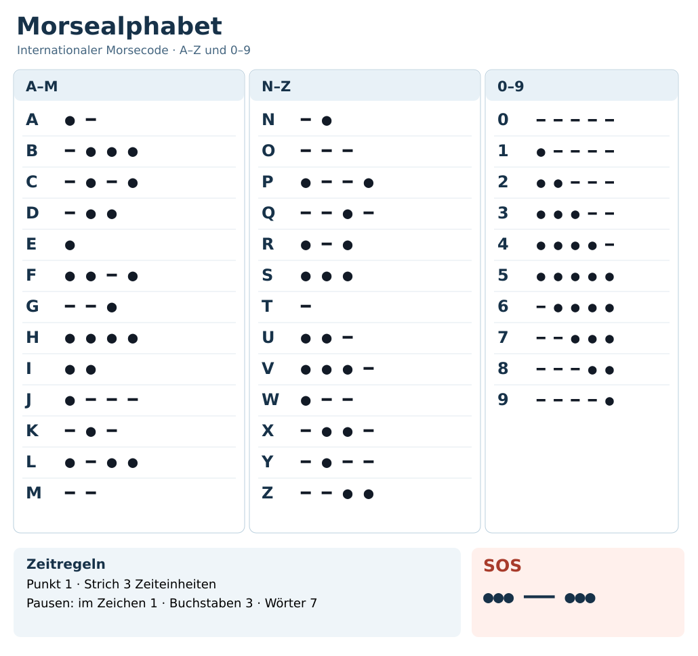

# Morsealphabet – internationaler Morsecode

!!! info "Status: Quellenbasierter Entwurf"
    Zeichen und Zeitregeln nach ITU-R M.1677-1 (2009) dokumentiert. Eine redaktionelle Prüfung steht noch aus (Stand: 25.10.2026).

## Kurzüberblick

Der **internationale Morsecode** stellt Buchstaben und Ziffern durch kurze Signale (**Punkte**) und lange Signale (**Striche**) dar. Er lässt sich durch Lichtblitze, hörbare Töne oder geeigneten Funk übertragen. Dafür sind ein gleichmäßiger Rhythmus und ein erreichbarer Empfänger notwendig.

{ width=100% }

## Buchstaben A–Z

| Buchstabe | Morsecode | Buchstabe | Morsecode |
| --- | --- | --- | --- |
| **A** | `.-` | **N** | `-.` |
| **B** | `-...` | **O** | `---` |
| **C** | `-.-.` | **P** | `.--.` |
| **D** | `-..` | **Q** | `--.-` |
| **E** | `.` | **R** | `.-.` |
| **F** | `..-.` | **S** | `...` |
| **G** | `--.` | **T** | `-` |
| **H** | `....` | **U** | `..-` |
| **I** | `..` | **V** | `...-` |
| **J** | `.---` | **W** | `.--` |
| **K** | `-.-` | **X** | `-..-` |
| **L** | `.-..` | **Y** | `-.--` |
| **M** | `--` | **Z** | `--..` |

## Ziffern 0–9

| Ziffer | Morsecode | Ziffer | Morsecode |
| --- | --- | --- | --- |
| **0** | `-----` | **5** | `.....` |
| **1** | `.----` | **6** | `-....` |
| **2** | `..---` | **7** | `--...` |
| **3** | `...--` | **8** | `---..` |
| **4** | `....-` | **9** | `----.` |

## Signalzeiten und Pausen

| Element | Länge |
| --- | ---: |
| Punkt | 1 Zeiteinheit |
| Strich | 3 Zeiteinheiten |
| Pause zwischen Bestandteilen eines Buchstabens | 1 Zeiteinheit |
| Pause zwischen Buchstaben | 3 Zeiteinheiten |
| Pause zwischen Wörtern | 7 Zeiteinheiten |

**SOS:** `... --- ...` – drei Punkte, drei Striche, drei Punkte. Im Funkverkehr wird das SOS-Notsignal zusammenhängend ohne reguläre Buchstabenpausen übertragen; die Dreiteilung ist eine Merkhilfe.

## So wird übermittelt

1. Signalmedium auswählen (etwa Taschenlampe, Pfeife oder geeignetes Morsefunkgerät) und Reichweite beziehungsweise Sicht- oder Hörkontakt sicherstellen.
2. Eine möglichst gleichmäßige Zeiteinheit wählen und zwischen Punkt, Strich und den unterschiedlichen Pausen klar unterscheiden.
3. Buchstaben der Nachricht nacheinander übermitteln. Wichtige Angaben und Notmeldungen bei vorhandenem Rückkanal bestätigen lassen.
4. Mit einfachen kurzen Nachrichten üben; für Adressen, Zahlen und Koordinaten auf Eindeutigkeit achten.

## Grenzen und Vorsicht

- Lichtzeichen und Töne benötigen freie Sicht- beziehungsweise Hörreichweite; Funk benötigt geeignete Geräte und verfügbare Frequenzen.
- Signale sind meist öffentlich wahrnehmbar und können den eigenen Standort verraten.
- Für Funkübertragungen die geltenden Vorschriften beachten; in akuten Notfällen verfügbare etablierte Rettungs- und Warnkanäle bevorzugen.

## Quellen

- Internationale Fernmeldeunion (ITU), [ITU-R M.1677-1 – International Morse code](https://www.itu.int/rec/R-REC-M.1677-1-200910-I/), 10/2009 (Zugriff: 25.10.2026).
- American Radio Relay League, [A Standard for Morse Timing Using the Farnsworth Technique](https://www.arrl.org/files/file/Technology/x9004008.pdf) (Zugriff: 25.10.2026).

**Redaktioneller Status:** Quellenbasierter Entwurf; fachlicher Review ausstehend.
