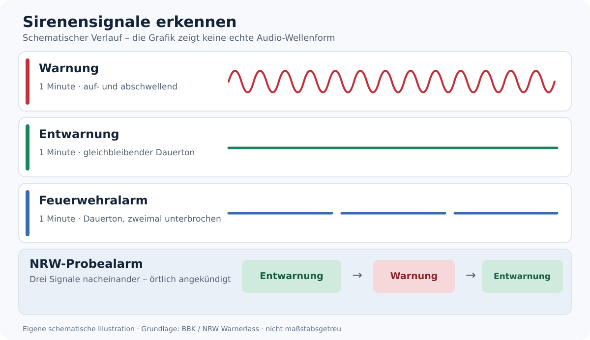

# Sirenensignale verstehen – Warnung, Entwarnung und Probealarm

!!! info "Quellenbasierter Entwurf"
    Amtliche Quellen (BBK, NRW, Kommunen) wurden herangezogen. Lokale Zusatzsignale sind möglich. Redaktionelle Prüfung steht noch aus. Stand: 26.10.2026.

## Sirenensignale auf einen Blick

{ width=100% }

*Die Linien illustrieren die Signalabfolge; sie sind keine exakten Audiospektren oder Frequenzverläufe.*

| Signal | Hörbares Muster | Dauer | Was bedeutet das? |
| --- | --- | --- | --- |
| **Warnung der Bevölkerung** | Auf- und abschwellender Heulton: **↗ ↘ ↗ ↘** | **1 Minute** | **Gefahr!** Über Radio oder amtliche Warnkanäle Informationen und Verhaltensempfehlungen einholen. |
| **Entwarnung** | Gleichbleibender Dauerton: **━━━━━━━━** | **1 Minute** | Die zuvor angekündigte akute Gefahr ist vorüber. Weitere amtliche Hinweise beachten. |
| **Feuerwehralarm** | Dauerton mit **zwei Unterbrechungen**: **━━━━  ━━━━  ━━━━** | **1 Minute insgesamt** | Alarmierung von Feuerwehrkräften, keine eigene Warnung an die Bevölkerung. Wird nicht überall genutzt. |
| **Probealarm in NRW** | **Entwarnung → Warnung → Entwarnung** | Drei Signale von je einer Minute, mit zeitlichem Abstand | Geplanter Test; **kein einzelner zusätzlicher Sirenenton**. |
| **Örtliche Funktionsprobe (Beispiel Siegen)** | Kurzer Dauerton | **15 Sekunden** | Lokaler Sirenentest. **Nicht bundesweit einheitlich**. |

**Merken:** Auf und ab = Gefahr. Konstant = Entwarnung. Zweimal unterbrochen = Feuerwehr. Die Kombination Entwarnung–Warnung–Entwarnung wird in Nordrhein-Westfalen bei angekündigten Probealarmen verwendet.

!!! warning "Probealarm nicht mit Entwarnung verwechseln"
    Ein einzelner Dauerton bedeutet in den bundesweit vorgesehenen Signalen **Entwarnung**, nicht allgemein „Probealarm“. Nur ein angekündigter Test, sein definierter Ablauf und zusätzliche amtliche Meldungen lassen eine Probe erkennen. Fehlt diese Bestätigung, eine echte Gefahrenlage nicht ausschließen.

## Was die Sirene nicht verrät

Die Sirene kann **nicht unterscheiden**, ob es um Hochwasser, Gefahrstoffe, einen Großbrand oder eine andere Bedrohung geht. Sie ist ein **Weck- und Aufmerksamkeitssignal**, keine vollständige Durchsage. Der Grund, das betroffene Gebiet und erforderliche Schutzmaßnahmen werden über andere Warnmittel bekanntgegeben. Auch fehlende Sirenen bedeuten **keine Entwarnung**: Sie sind nicht überall vorhanden oder hörbar.

## Richtig reagieren, wenn der Warnton ertönt

1. **Ruhe bewahren und die unmittelbare Umgebung beachten.** Sich nicht in einen erkennbar gefährlichen Bereich begeben.
2. **Offizielle Informationen einholen:** Batterie-/Kurbelradio (lokaler Sender), [warnung.bund.de](https://warnung.bund.de/), NINA-App und offizielle Mitteilungen der Gemeinde.
3. **Gefahrenspezifische Anweisungen beachten.** Bei einer Schadstoffwolke können geschlossene Fenster und abgeschaltete Lüftung schützen; bei Brand oder Evakuierung können andere Maßnahmen nötig sein. Nicht allein aus dem Sirenenton eine bestimmte Gefahr oder Maßnahme ableiten.
4. **Andere warnen und unterstützen**, wenn dies ohne Eigengefährdung möglich ist. **110 und 112 nur für echte Notfälle** nutzen.
5. Bei einem Entwarnungston **weitere Hinweise prüfen**. Sperrungen und Vorsichtsmaßnahmen können noch bestehen.

## Wie funktioniert der Probealarm?

Nordrhein-Westfalen legt im **Warnerlass (2020), Abschnitt 3.1.2.3**, die Folge **Entwarnung – Warnung – Entwarnung** fest. Empfohlen ist, die Signale **in einem zeitlichen Abstand von fünf Minuten** auszulösen. Es handelt sich also um eine **Tonfolge**, nicht um eine vierte einheitliche Tonmelodie.

| Reihenfolge | Signal | Klang |
| ---: | --- | --- |
| 1 | **Entwarnung** | 1 Minute gleichbleibender Ton |
| 2 | **Warnung** | 1 Minute auf- und abschwellender Ton |
| 3 | **Entwarnung** | 1 Minute gleichbleibender Ton |

In NRW gibt es den **landesweiten Warntag am zweiten Donnerstag im März**; der **bundesweite Warntag im September** umfasst NRW ebenfalls. Die Durchführungszeiten und die Beteiligung der Sirenen können regional abweichen. Proben werden öffentlich angekündigt und über begleitende Meldungen als **Test ohne Gefahr** gekennzeichnet. Sich nie ausschließlich auf Datum oder Uhrzeit verlassen.

**Wichtige Ausnahme:** Einzelne Kommunen verwenden zusätzliche **lokale Funktionsproben**. Die Stadt **Siegen** beschreibt beispielsweise einen **15 Sekunden langen Dauerton** ausdrücklich als „Probealarm“. Dieses Signal ist **nicht bundesweit standardisiert** und darf nicht einfach auf Duisburg oder andere Orte übertragen werden.

## Duisburg: lokale Warninformationen

Die [Feuerwehr Duisburg](https://www.duisburg.de/microsites/feuerwehr/060/krisenmanagement/warnungen-der-bevoelkerung) nennt für die Bevölkerung:
- **Warnung:** eine Minute auf- und abschwellender Heulton.
- **Entwarnung:** eine Minute Dauerton.
- **[Hörprobe Warnung (MP3)](https://www.duisburg.de/allgemein/fachbereiche/Katastrophenalarm.mp3)** und **[Hörprobe Entwarnung (MP3)](https://www.duisburg.de/allgemein/fachbereiche/Entwarnung.mp3)**: Offizielle Klangbeispiele der Stadt; die Dateien werden nicht im Guide gespiegelt.
- **Radio Duisburg:** UKW **92,2 MHz**.
- **Gefahrentelefon:** **0800 112 13 13** für Ansagen bei Warnlagen, **kein Notruf**.

Für aktuelle Meldungen außerdem [warnung.bund.de](https://warnung.bund.de/), NINA und die Website der Stadt verwenden. Wo andere Sirenentöne eingesetzt werden, gelten die von der jeweiligen Gemeinde veröffentlichten Bedeutungen.

## Grenzen und Ausrüstung

Ein **batteriebetriebenes Radio**, gespeicherte Lokalradiofrequenzen und eine Taschenlampe erleichtern das Einholen von Warnungen bei Stromausfall. Hörbarkeit hängt von Sirenenstandort, Wind, Bauweise, Fenstern und Hintergrundlärm ab. Gefährdete oder schwerhörige Menschen auf anderen Kanälen einbeziehen.

## Nach einer Warnung weiter vorgehen

Der Ton ist **noch keine Handlungsanweisung**. [Die ersten 72 Stunden](../00-grundlagen/erste-72-stunden.md) helfen, die unmittelbare Standortgefahr und die anschließenden Maßnahmen einzuordnen. Wenn Mobilfunk und übliche Radios ausfallen, zuerst [vorhandene Empfangsgeräte prüfen](../05-technologie/radio-ohne-geraet.md). Eine [private Funk-Zeitabsprache](funkzeitfenster-333-regel.md) ersetzt **keine** amtliche Warnung.

## Quellen

- Bundesamt für Bevölkerungsschutz und Katastrophenhilfe (BBK), [Sirenen und bundesweite Signale](https://www.bbk.bund.de/DE/Warnung-Vorsorge/Warnung-in-Deutschland/So-werden-Sie-gewarnt/Sirenen/sirenen_node.html), Zugriff 26.10.2026.
- BBK, [Wie wird gewarnt? – Sirenen und Feuerwehrsignal](https://www.bbk.bund.de/DE/Warnung-Vorsorge/Bundesweiter-Warntag/Wie-wird-gewarnt/wie-wird-gewarnt_node.html), Zugriff 26.10.2026.
- Ministerium des Innern NRW, [Warnerlass vom 26.05.2020, Ziffer 3.1.2](https://recht.nrw.de/mblnrw/2020-s283-0/), Zugriff 26.10.2026.
- Ministerium des Innern NRW, [Landesweiter Warntag am 12.03.2026](https://www.im.nrw/landesweiter-warntag-am-donnerstag-heulen-wieder-die-sirenen-und-handys), Zugriff 26.10.2026.
- Stadt Siegen, [Warnung und Information der Bevölkerung (örtlicher 15-Sekunden-Probeton)](https://www.siegen.de/leben-in-siegen/bevoelkerungsschutz/warnung-und-information-der-bevoelkerung), Zugriff 26.10.2026.
- Feuerwehr Duisburg, [Warnung der Bevölkerung mit Hörbeispielen und Lokalradio](https://www.duisburg.de/microsites/feuerwehr/060/krisenmanagement/warnungen-der-bevoelkerung), Zugriff 26.10.2026.

**Status:** Quellenbasierter Entwurf; abschließende redaktionelle Prüfung ausstehend.
