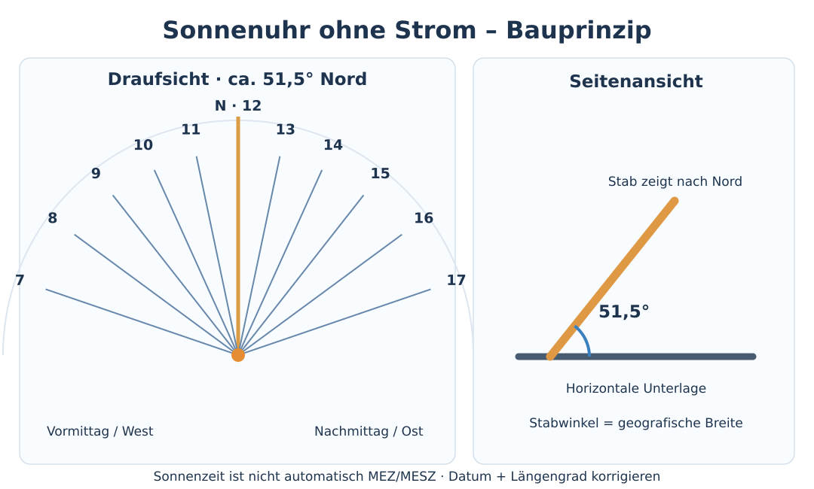

# Uhrzeit am Sonnenstand bestimmen – Sonnenuhr selbst bauen

!!! info "Quellenbasierter Entwurf – praktische Erprobung ausstehend"
    Für Mitteleuropa beschrieben, mit Beispiel Duisburg (ca. 51,5° Nord, 6,75° Ost). Geometrie und Zeitkorrektur sind quellenbasiert; **ein reproduzierbarer Feldtest am selbst gebauten Modell steht aus**. Stand: 26.10.2026.

## Warum das im Katastrophenfall wichtig ist

Wenn alle Uhren ausfallen, verrät der Sonnenstand die **lokale wahre Sonnenzeit**. So lassen sich Tagesabläufe und ein ungefährer Mittag rekonstruieren – ganz ohne Strom und Funk. Für die minutengenauen [Funk-Zeitfenster der 3-3-3-Regel](../04-kommunikation/funkzeitfenster-333-regel.md) ist eine unkalibrierte Sonnenuhr jedoch **kein gleichwertiger Ersatz** für eine synchronisierte Uhr. Wo noch möglich, zuerst eine mechanische/Quarzuhr retten oder den [DCF77-Zeitfunk](../05-technologie/dcf77-zeitfunk.md) empfangen.

**Grundprinzip:** Die Sonne steht zur *wahren Ortsmittagszeit* im Süden am höchsten. Der Schatten eines senkrechten Stabs ist dann für diesen Tag am kürzesten und weist in Deutschland ungefähr nach **geografisch Nord**. Um diesen Mittag herum zeigt eine richtig ausgerichtete Sonnenuhr die Sonnenstunden an.

{ width=100% }

## Notlösung: Mittag und Himmelsrichtungen ohne Uhr finden

**Material:** gerader Stab (etwa 30–100 cm), ebener Platz, Stein/Kreide/Schnur und etwas Geduld.

1. Stab **senkrecht** in den Boden stecken. Fußpunkt fest markieren.
2. Über die Zeit immer wieder die **Spitze des Schattens** markieren. Er wird morgens kürzer und nachmittags länger. Die kürzeste Strecke vom Stabfuß zur Schatten­spitze kennzeichnet grob den wahren **Mittag**.
3. Die Richtung vom Fußpunkt zur kürzesten Schattenspitze zeigt in Deutschland ungefähr **Nord**, entgegengesetzt liegt **Süd**. Diese Nord-Süd-Linie dauerhaft markieren.
4. **Genauer für die Nord-Süd-Linie:** Morgens um den Fußpunkt mit einer Schnur einen Kreis ziehen, der gerade durch eine markierte Schattenspitze verläuft. Nachmittags den Zeitpunkt abwarten, an dem die Schattenspitze **denselben Kreis** erneut schneidet. Die Verbindung der beiden Punkte ist ungefähr West–Ost; die senkrechte Mittellinie ist Nord–Süd. Den Nordast über die Mittagsrichtung prüfen.

!!! warning "Nur ein Zeitanker"
    Der kürzeste Schatten ergibt **12:00 wahre Ortszeit**, in Duisburg keineswegs automatisch 12:00 MEZ/MESZ. Ein einzelner Mittagspunkt liefert noch keine Anzeige für 09:00, 15:00 oder eine volle Stunde. Bei bedecktem Himmel funktioniert das Verfahren nicht.

## Bauanleitung: horizontale Sonnenuhr

**Material:** ebene Holzplatte/Karton oder Pflasterfläche, langer Nagel/gerader Draht bzw. Holzstab als *Schattenwerfer (Gnomon)*, Lineal, Winkelmesser, Kleber oder Stütze.

1. Auf der Platte einen **Mittelpunkt** und eine Nord-Süd-Linie einzeichnen. Auf dieser Linie weist die **12-Uhr-Stundenlinie nach Norden**.
2. Einen geraden Schattenstab vom Mittelpunkt aus **in Richtung geografisch Nord** so befestigen, dass er gegen die Waagerechte im Winkel deiner **geografischen Breite** ansteigt. In Duisburg sind das ungefähr **51,5°**. Ein dreieckiges Stützstück aus Karton oder Holz erleichtert das. Ein **senkrechter** Stab eignet sich zwar zur Mittagsbestimmung, **nicht** für diese vorgedruckten Stundenlinien.
3. Von der 12-Uhr-Linie aus die Stundenlinien mit dem Winkelmesser abtragen. **Vormittag links (Westen), Nachmittag rechts (Osten)**, wenn Norden auf der Zeichnung oben liegt.
4. Sonnenuhr **waagerecht** aufstellen und die eingezeichnete Nordrichtung an der zuvor gefundenen geografischen Nordrichtung ausrichten. Nur der Schatten des schrägen Stabes bzw. der schrägen Kante ist die Anzeige.
5. Ablesen: Der Schatten wandert im Tagesverlauf über die Stundenlinien. Dazwischen möglichst interpolieren; anschließend die **Längen- und Datums­korrektur** anwenden.

| Sonnenzeit | Winkel zur Nord-/12-Uhr-Linie | Seite |
| --- | ---: | --- |
| 07 / 17 Uhr | ca. 71° | West / Ost |
| 08 / 16 Uhr | ca. 54° | West / Ost |
| 09 / 15 Uhr | ca. 38° | West / Ost |
| 10 / 14 Uhr | ca. 24° | West / Ost |
| 11 / 13 Uhr | ca. 12° | West / Ost |
| 12 Uhr | 0° | Nord |

Diese Winkel gelten **für eine horizontale Sonnenuhr bei ungefähr 51,5° Nord**. Die Stundenstriche sind *nicht* jeweils 15° auseinander; das wäre die Skala einer **äquatorialen**, anders gebauten Sonnenuhr. Allgemein gilt für den Betrag des Winkels: `arctan(sin(Breite) × tan(15° × Stundenabstand von 12))`, für den Stundenabstand von 0 bis unter 6 Stunden.

## Von Sonnenzeit zu MEZ / MESZ

Bei einer Sonnenuhr ergeben sich **zwei** systematische Unterschiede zur deutschen Uhrzeit:

- **Längengrad:** Der Referenzmeridian der MEZ liegt bei **15° Ost**. Duisburg liegt ungefähr bei **6,75° Ost**. Der örtliche Sonnentag ist deshalb gegenüber MEZ um **33 Minuten** verschoben.
- **Zeitgleichung (E):** Aufgrund von Erdachsenneigung und elliptischer Erdbahn kann die wahre Sonnenzeit gegenüber der mittleren Sonnenzeit je nach Datum bis etwa **16 Minuten vor- oder nachgehen**. Hier ist `E = wahre Sonnenzeit − mittlere Sonnenzeit` definiert.

**Für Duisburg gilt näherungsweise:**

`MEZ = abgelesene Sonnenzeit + 33 Minuten − E`

`MESZ = abgelesene Sonnenzeit + 93 Minuten − E`

| Ungefährer Monatstag: 15. | E (gerundet) | Ungefährer Monatstag: 15. | E (gerundet) |
| --- | ---: | --- | ---: |
| Januar | −9 min | Juli | −6 min |
| Februar | −14 min | August | −5 min |
| März | −10 min | September | +5 min |
| April | 0 min | Oktober | +14 min |
| Mai | +4 min | November | +15 min |
| Juni | 0 min | Dezember | +5 min |

Die Werte sind **Monats-Mitte-Näherungen**, keine tagesgenaue Tabelle. **Beispiel:** Ende Oktober ist `E` ungefähr +16 min; in Duisburg bedeutet **12:00 Sonnenzeit ungefähr 12:17 MEZ**. Während der deutschen Sommerzeit wäre es entsprechend **13:17 MESZ**. Den Wechsel zwischen MEZ und MESZ nicht aus der Sonne allein ableiten; der Kalender bzw. eine bekannte Vereinbarung ist notwendig. Außerhalb Duisburgs pro Längengrad weiter östlich **4 Minuten weniger** Längenkorrektur ansetzen, weiter westlich **4 Minuten mehr**.

!!! tip "Auch ohne Korrekturtabelle nutzbar"
    Für einen groben Tagesplan genügt der wahre Mittag als Bezugspunkt. Alle Mitglieder einer Gruppe können beispielsweise ein gemeinsames Empfangsfenster **um lokalen Sonnenmittag** festlegen, sollten dafür aber **deutlich längere Hörfenster** vereinbaren. Das ist **nicht** dieselbe Konvention wie die 3-3-3-Regel zu festen bürgerlichen Uhrzeiten.

## Selbstversuch und Prüfung

1. Bei Sonne die geografische Nordrichtung mit dem Kreisverfahren bestimmen; Sonnenuhr fertig aufstellen.
2. Vor dem Ablesen **Datum**, **Längengrad** und **MEZ/MESZ** festhalten.
3. Schattenzeit ablesen, Korrektur berechnen und **unabhängig** gegen eine verlässlich synchronisierte Uhr prüfen (nur beim Übungsversuch). Mindestens morgens, um Mittag und nachmittags erneut vergleichen.
4. Fehler und Ursachen notieren: Breitengrad falsch, Platte schief, Schattenstab senkrecht statt geneigt, Nordausrichtung ungenau, Zeitgleichung oder Sommerzeit falsch.
5. Danach erst beurteilen, ob die eigene Konstruktion als grobe Funk-Zeitstütze taugt. **Dieses Experiment wurde für diesen Leitfaden noch nicht durchgeführt.**

## Grenzen und Alternativen

- Die Sonne liefert **nachts**, bei dichtem Wolkenhimmel oder in geschlossenen Räumen keine Anzeige; eine alte aufziehbare Uhr, Quarzuhr mit Batterie oder Funkuhr ist robuster.
- Ohne Standort, Kalender und Sommerzeitinformation ist aus der **wahren Ortszeit** keine bundesweit synchronisierte gesetzliche Uhrzeit ableitbar.
- Eine unkalibrierte oder schief aufgestellte Sonnenuhr kann leicht viele Minuten falsch liegen; die Ablesung verschlechtert sich bei diffusem Schatten.
- Nicht direkt in die Sonne schauen; auch nicht mit optischen Hilfsmitteln.

## Quellen

- U.S. Naval Observatory, [The Equation of Time](https://aa.usno.navy.mil/faq/eqtime): Definition und Vorzeichen der Zeitgleichung, Unterschied zwischen wahrer Sonnenzeit und Zonenzeit.
- NOAA Global Monitoring Laboratory, [Solar Calculator](https://gml.noaa.gov/grad/solcalc/): Sonnenhöchststand und Zeitgleichung; Monatswerte oben gerundete Berechnung nach der gebräuchlichen NOAA-Näherungsformel.
- Seiko Museum, [Sundials](https://museum.seiko.co.jp/en/kids/know/nature_04.html): Ausrichtung des Schattenwerfers parallel zur Erdachse.
- Axminster Tools, [How to make a sundial](https://www.axminstertools.com/ideas-advice/how-to-make-a-sundial/): horizontaler Zifferblattaufbau und Breitenwinkel.

**Redaktioneller Status:** Quellenbasierter Entwurf; geometrischer Praxisversuch und fachlicher Review ausstehend.
