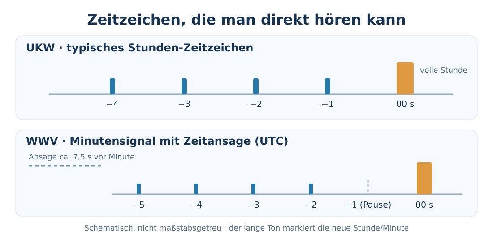

# Uhrzeit mit hörbaren Rundfunk-Zeitzeichen bestimmen

!!! info "Quellenbasierter Entwurf – Praxistest offen"
    Stand: 26.10.2026. Ob ein Sender im Krisenfall noch läuft, ist nicht vorhersehbar. Die hier beschriebenen Empfangswege sind noch nicht im Rahmen dieses Leitfadens erprobt.

**Vor dem DCF77-Selbstbau prüfen, ob ein Empfangsgerät vorhanden ist oder [aus Altgeräten gewonnen werden kann](../05-technologie/radio-ohne-geraet.md).** Beim sogenannten *akustischen Zeitzeichen* markieren hörbare Pieptöne den Beginn einer Minute oder Stunde. Manche Sender sagen die Uhrzeit sogar laut an – man muss keine Bits dekodieren.

{ width=100% }

!!! warning "Eine Zeitmarke ist keine vollständige Uhr"
    Pieptöne allein markieren meist nur „jetzt beginnt eine Minute/Stunde“. **Ohne Ansage oder bestehenden Zeitanker erfährt man nicht, welche Uhrzeit das ist.** Wenn alle Uhren stehen geblieben sind, liefert die Minute auch **keine Zeitmessung für die nächsten drei Stunden**, nachdem das Radio ausgeschaltet wurde.

## Die wichtigsten Empfangsmöglichkeiten

| Sender | Geeigneter Empfänger | Was man hören kann | Realistische Bedeutung |
| --- | --- | --- | --- |
| **Deutschlandfunk** | Normales **analoges UKW-Radio**; Duisburg: **102,8 MHz** (Wesel) | Stündliche Nachrichten als grober Zeitanker; **aktuelle genaue Pieptöne nicht verifiziert** | **Zuerst versuchen**, falls die Rundfunkversorgung noch funktioniert |
| **WWV (USA)** | **Kurzwelle mit AM**, u. a. 5, 10, 15 MHz | **Jede Minute gesprochene UTC-Uhrzeit**, Sekundenticks und langer Minutenton | Kein Decoder erforderlich, aber **kein garantierter Empfang in Deutschland** |
| **RWM (Russland)** | **Kurzwelle mit CW/SSB und BFO**, 4,996 / 9,996 / 14,996 MHz | Sekundenimpulse und verlängerte Minutenmarken (je nach Sendeabschnitt) | Liefert einen **Takt**, aber **keine gesprochene absolute Zeit** |
| **CHU (Kanada)** | Früher Kurzwelle 3,330 / 7,850 / 14,670 MHz | Früher Zeitansagen und Impulse | **Nicht mehr als Option einplanen:** laut NRC seit **22.06.2026 eingestellt** |

**Duisburg:** 102,8 MHz ist beim Deutschlandfunk offiziell als Empfangsfrequenz aus **Wesel** für die Region gelistet. Die Frequenz gilt **nicht bundesweit**. Ein herkömmliches UKW-Radio benötigt weder Internet noch Mobilfunk.

## Anleitung: Uhr am UKW-Zeitzeichen stellen

1. Ein Batterie- oder Kurbelradio einschalten. In Duisburg zuerst **Deutschlandfunk auf 102,8 MHz** versuchen; alternativ einen anderen Sender mit hörbarer Zeitsignalisierung.
2. Auf **Nachrichten zur vollen Stunde** achten. **Ob Deutschlandfunk aktuell eine klassische kurze/lange Pieptonfolge sendet, ist nicht unabhängig bestätigt**; die allgemeine Grafik stellt kein verifiziertes DLF-Signal dar. Nur **wenn tatsächlich ein klar identifizierbares Zeitzeichen** hörbar ist, kann der Beginn des abschließenden langen Tons als Stundenmarke dienen.
3. Den **Stundenwert anhand einer Ansage** oder des eindeutig bekannten Programms ermitteln, nicht allein aus einem beliebigen Nachrichtengong. **Beginn der Nachrichten ist keine garantierte Sekundengrenze.**
4. Falls noch eine funktionierende mechanische oder elektronische Uhr existiert, **genau auf die Zeitmarke stellen**. Die Zeit gegebenenfalls durch das nächste Signal kontrollieren.
5. Ist keine Uhr mehr lauffähig, **Zeitanker auf Papier notieren**. Für die laufende Zeitmessung benötigt man weiterhin ein Verfahren, das Minuten und Stunden überbrückt.

**Wichtig:** Auch analoges UKW bietet **keine garantierte sekundengenaue Zeit**: Sendeablauf und Studioübertragung können verzögern. Bei **DAB+, Internetradio und Satellitenradio** kommen zusätzliche Puffer- und Dekodierverzögerungen dazu; zur Uhrsynchronisierung möglichst direktes UKW bevorzugen. Nicht jeder Sender liefert stündlich ein verlässliches Zeitzeichen.

## Anleitung: WWV mit einem Kurzwellenradio abhören

Der US-Zeitsender **WWV** bei Colorado sendet hörbare Signale auf **2,5 / 5 / 10 / 15 / 20 MHz**.

1. **AM-Kurzwellenempfänger** benutzen. Zum Beispiel **10.000 kHz** einstellen, bei fehlendem Empfang auch **5.000** oder **15.000 kHz** ausprobieren. Die Ausbreitung über den Atlantik ist unsicher und schwankt stark.
2. Die **kurzen Ticks im Sekundentakt** erkennen. **Etwa 7,5 Sekunden vor jedem Minutenbeginn** nennt eine Stimme die Uhrzeit der *kommenden* Minute, **in UTC**.
3. Die Sekundenmarke bei **Sekunde 59 entfällt**. Mit dem **folgenden langen Ton** beginnt genau die vorher angesagte Minute. Erst **bei diesem Ton** die Uhr einstellen.
4. Zeit umrechnen: **MEZ = UTC + 1 Stunde**; **MESZ = UTC + 2 Stunden**. Beispiel: `14:25 UTC` wird zu `15:25 MEZ` beziehungsweise `16:25 MESZ`. Die gültige Sommer-/Winterzeit setzt **Kalenderwissen** voraus.

**Vorteil:** Mit dem passenden Empfänger braucht man keinerlei Bit-Tabelle. **Nachteil:** Der Sender liegt in den USA; ein Signal in Deutschland kann vollständig ausbleiben.

## RWM: präzise Minutenmarken ohne Ansage

**RWM** ist ein russischer Kurzwellen-Zeitzeichensender auf **4.996 / 9.996 / 14.996 kHz**. Nach veröffentlichtem Sendeplan erfolgen zeitweise **Sekundenpulse**, deren **Minutenbeginn durch einen längeren Impuls** markiert ist; in anderen Zeitabschnitten Morsezeichen, Pausen oder schnellere Pulse.

Ein **CW-/SSB-Empfänger mit BFO** macht das getastete Signal hörbar. Ein normales UKW- oder einfaches AM-Radio reicht dazu nicht. **Aus einem solchen Minutenpieps allein erfährt man nicht, ob es 09:00, 14:00 oder 18:00 Uhr ist.** RWM eignet sich somit vor allem, eine ungefähr bekannte Zeit fein abzugleichen.

## Für die 3-3-3-Regel

Die [Funk-Zeitfenster nach der 3-3-3-Regel](funkzeitfenster-333-regel.md) sind in **deutscher Ortszeit** vorgesehen. **Priorität:** vorhandene Uhr erhalten → mit lokalen Rundfunk-Zeitzeichen synchronisieren → gegebenenfalls WWV versuchen → [Sonnenuhr](zeitbestimmung-sonne.md) als grober Anker → erst dann [DCF77-Elektronik](../05-technologie/dcf77-zeitfunk.md) improvisieren.

Wenn kein zuverlässiger Zeitmesser mehr vorhanden ist, **nicht einfach annehmen, die 3 Minuten Hörbereitschaft träfen dieselbe Zeit wie bei anderen Gruppen**. Nur nach gemeinsamer Absprache auf längere, relative Empfangsfenster ausweichen. Bei akuter Gefahr niemals wegen eines Zeitsignals mit einem Hilferuf warten.

## Praxistest (offen)

- Ob DLF überhaupt eine **hörbare klassische Stundenkennung** sendet, zuerst **real abhören**; allenfalls dann ihren Versatz gegen eine zuverlässig synchronisierte Uhr prüfen.
- Bei einem geeigneten KW-Radio **WWV empfangen** und eine angekündigte UTC-Minutenmarke identifizieren; tatsächliche Empfangbarkeit in Deutschland protokollieren.
- Uhrzeit und Datum, Empfangsart, Frequenz, Empfangsort und beobachtete Verzögerungen aufschreiben. Erst danach die jeweilige Methode als praktisch bestätigt markieren.

## Quellen

- [Deutschlandfunk: UKW-Frequenzsuche](https://www.deutschlandfunk.de/frequenzsuche) – Frequenz 102,8 MHz (Wesel) im Raum Düsseldorf/Duisburg.
- [NIST: Station WWV](https://www.nist.gov/pml/time-and-frequency-division/time-distribution/radio-station-wwv) – Kurzwellensendefrequenzen und Betrieb.
- [NIST: WWV-Zeitzeichen und Sendeformat](https://www.nist.gov/pml/time-and-frequency-division/time-distribution/radio-station-wwv/wwv-and-wwvh-digital-time-code) – Sekunden-, Minuten- und Sprachansagen.
- [NRC Kanada: CHU-Status](https://nrc.canada.ca/en/chu-short-wave-station/) – Einstellung zum 22. Juni 2026; die noch angezeigten „online“-Statusfelder stehen im Widerspruch zum expliziten Einstellungsvermerk.
- [Standard Frequency and Time Signal Stations, RWM-Zeitplan](https://time.ewha.or.kr/download/std_time_stations.pdf) – RWM-Frequenzen und Impulsfolgen.
- [Zeitzeichen (Tonfolge)](https://de.wikipedia.org/wiki/Zeitzeichen_%28Tonfolge%29) – typische akustische Zeichen und Einschränkungen digitaler Ausspielwege.

**Status:** Quellenbasierter Entwurf, weder Rundfunkempfang noch Zeitzeichen lokal erprobt. Insbesondere **DLF-Pieptöne sind unbestätigt**; Uhrzeit aus RDS-CT oder gesprochener Ansage prüfen.
