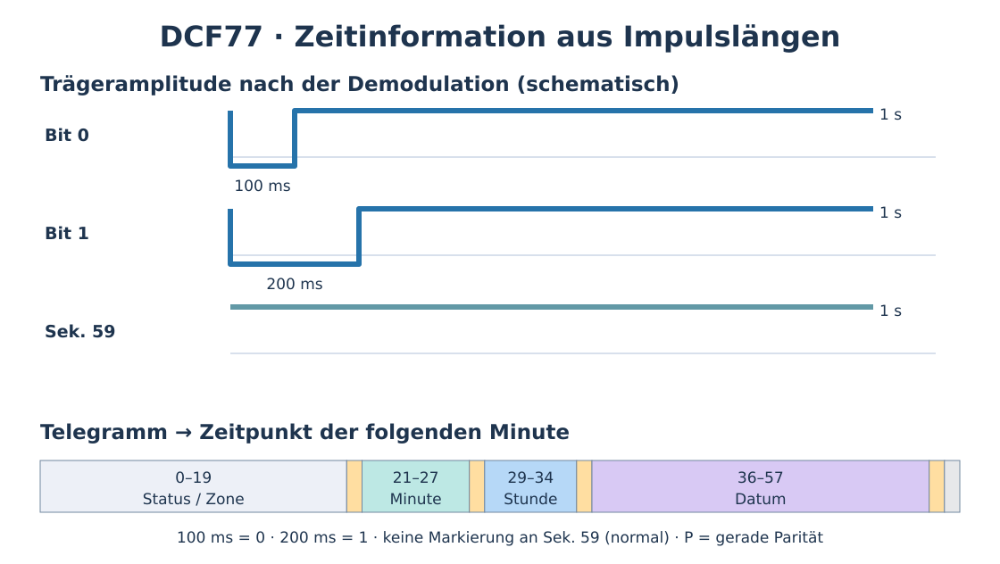

# DCF77: Zeitsignal empfangen und von Hand dekodieren

!!! warning "Elektronik-Bauanleitung – experimentell, nicht feldgetestet"
    Das Signalformat ist durch die Physikalisch-Technische Bundesanstalt (PTB) dokumentiert. Die folgende **batteriebetriebene Niedervolt-Schaltung** ist als Beispiel für einen bestimmten *Open-Collector-Empfängerausgang* beschrieben, nicht als universeller Anschlussschaltplan für alle Funkuhrmodule. **Nicht praktisch am realen Modul getestet**. Vor Nachbau Datenblatt, Polarität und Versorgungsspannung prüfen. Stand: 26.10.2026.

## Idee und Grenzen

DCF77 ist der deutsche Langwellen-Zeitzeichensender bei **77,5 kHz** in **Mainflingen bei Frankfurt am Main**. Der Sender überträgt amtliche Zeitinformation, darunter Minute, Stunde, Datum und Sommer-/Normalzeit. **DCF77 ist kein Sprachfunk und nicht direkt mit normalen AM-/UKW-Radios hörbar.** Die 77,5-kHz-Trägerwelle liegt weit oberhalb des Hörbereichs; erst ein passender Empfänger wandelt ihre Amplitudenabsenkungen in elektrische Impulse um. Diese lassen sich mit LED oder Aktivsummer sichtbar bzw. hörbar machen.

DCF77 benötigt für den Empfang **keine Internetverbindung**, hängt aber vom **weiter betriebenen Sender und dessen technischer Versorgung** ab. Bei einem überregionalen Zusammenbruch ist es deshalb **keine garantierte Zeitquelle**. Eine intakte batteriebetriebene Funkuhr ist die mit Abstand einfachste Lösung; die hier beschriebene Bastelvariante ist eine Rückfallebene.

{ width=100% }

## Was zeigt das Signal eigentlich?

Pro Sekunde wird **zu Sekundenbeginn** die Amplitude des Trägers kurz abgesenkt:

| Beobachtung am **demodulierten Ausgang** | Bedeutung |
| --- | --- |
| Absenkung für **100 ms** | Datenbit **0** |
| Absenkung für **200 ms** | Datenbit **1** |
| In der **Sekunde 59** normalerweise **keine** Absenkung | Minutenende / Minuten-Synchronisation |

Die Absenkung betrifft die **Funkamplitude**; ein Empfängermodul kann die Markierung je nach Ausgang **als HIGH oder LOW** ausgeben. Ein Summer erzeugt deshalb **erst hinter der Demodulation** kurze Töne. **Nur nach Gehör** lassen sich 100 und 200 ms oft schlecht sicher unterscheiden – für zuverlässige Handdekodierung die Pulslänge elektronisch messen oder aufzeichnen.

Ein vollständiges Telegramm beschreibt die Uhrzeit **der nächsten Minute**. Beispiel: Wird während 14:24 das Telegramm mit **14:25** gesendet, beginnt nach der folgenden Minutenlücke um **14:25:00** diese Uhrzeit. Eine einzelne 1-Hz-Folge ohne Minute- und Paritätsprüfung beweist **keinen gültigen Zeitcode**.

## Material aus vorhandener Technik gewinnen

**Priorität im Krisenfall, ohne unnötige Beschaffungsrisiken:**

1. **Eine funktionsfähige DCF77-Funkuhr, Funkwecker oder Funk-Wetterstation mitnehmen bzw. legal aus Altbestand verwenden.** Nach Batteriewechsel selbst synchronisieren lassen; vor Zerlegen prüfen, ob Anzeige und Zeitweiterlauf bereits funktionieren.
2. Ist die Anzeige defekt: in einer alten Funkuhr nach einer **Ferritstabantenne mit Wicklung** und der dazugehörigen **DCF77-Empfängerplatine** suchen. Antenne **zusammen mit ihrer abgestimmten Elektronik** ausbauen; nicht einfach an ein UKW-Radio anschließen.
3. Aus Elektronikschrott mit Zustimmung: 2× AA-Batteriehalter, dünner Draht, ggf. BC557-PNP-Transistor (oder kompatibel), LED, Widerstände 330 Ω / 22 kΩ / 47 kΩ, kleine Lochrasterplatte oder isolierte Verbindungsdrähte. Optional ein **aktiver** Summer für **3 V**, der selbst einen Ton erzeugt.
4. Ein vorhandener **77,5-kHz-DCF77-Empfängerbaustein** mit Antenne ist deutlich einfacher als ein komplett neuer Hochfrequenzempfänger. Bauart, Pinbelegung, Ausgangstyp und Betriebsspannung sind **nicht genormt**.

**Nicht benötigte bzw. ungeeignete Abkürzung:** Eine beliebige Drahtspule, Diode und ein Kopfhörer bilden ohne abgestimmten Resonanzkreis und ausreichend empfindliche Verstärkung **nicht verlässlich** einen DCF77-Empfänger. Das Auslegen einer vollständigen 77,5-kHz-Empfangsschaltung *aus Einzelbauteilen* erfordert unter anderem LC-Abstimmung, empfindlichen Vorverstärker, Hüllkurvendetektor und Impulsaufbereitung; diese Schaltungsvariante ist **hier noch nicht als geprüfter Bauplan dokumentiert**. Für einen Resonanzkreis gilt `f = 1 / (2π√(L×C))`: Mit **gemessenen** 10 mH ergäben sich bei 77,5 kHz theoretisch ca. 422 pF (zuzüglich Abgleich/parasitären Kapazitäten); dieser Wert passt **nicht** pauschal zu jedem Ferritstab.

## Aufbau A: Funkuhrmodul retten (bevorzugt)

1. Vorhandene Funkuhr mit 1,5-/3-V-Batteriebetrieb auf Funktion prüfen, frische Batterie einsetzen und **mehrere Minuten** für Synchronisation einplanen. Eine teils laufende Anzeige ist nicht notwendigerweise bereits funkgesteuert.
2. Bei zerlegtem Gerät den **Ferritstab mit Spule**, die zugehörigen Bauteile und die Empfängerplatine **als Einheit** erhalten; lackierten Spulendraht nicht abreißen.
3. Erst wenn die Bezeichnung des Moduls samt Datenblatt geklärt ist: mit der dort genannten **stabilen Batteriespannung** versorgen. Antenne **horizontal** drehen, bis der beste Empfang entsteht; Abstand zu Schaltnetzteilen, LEDs mit Taktung, Computern und Metall vergrößern.
4. Modul-Ausgang mit einem **hochohmigen Messinstrument** prüfen (Signalimpulse im Sekundentakt). Reagiert es nicht: Start-/Enable-Pin, fehlenden Pull-up und Modul-Ausgangslogik anhand des **konkreten Datenblatts** prüfen.

## Aufbau B: Impulse mit einer LED sichtbar machen

**Diese Schaltung gilt nur, wenn das vorhandene DCF77-Modul einen bei einer Sekundenmarke nach Masse schaltenden, ausreichend belastbaren Open-Collector-Ausgang hat (aktiv LOW, mindestens ca. 0,2 mA Senkstrom).** Andere Module benötigen andere Beschaltung; insbesondere schwache Push-Pull-Ausgänge dürfen nicht wie Open-Collector-Ausgänge belastet werden.

**Anschlussplan für ein zu 3 V passendes Modul, 2× AA:**

```text
                    +3 V Batterie (+)
                     │        │
             Modul V+│        E  PNP BC557
                     │        │
                     │        C ── 330 Ω ── LED (>│) ── GND
                     │        B
                     │       ├── 47 kΩ ───────── +3 V
      Modul DATA ── 22 kΩ ────┘
      Modul GND ──────────────────────────────── GND / Batterie (−)
```

Dabei stehen **E / B / C** für Emitter / Basis / Kollektor. Die reale Pin-Reihenfolge des BC557 **anhand seines Datenblatts** prüfen (nicht aus der Skizze ableiten). Die LED **in Durchlassrichtung** zwischen Vorwiderstand und GND anschließen. LED und Widerstand gehören **in Reihe**, niemals die LED direkt an die Batterie. Für etwa 3 V ist eine rote LED meist besser geeignet als eine weiße/blaue.

1. Zuerst das Modul allein mit spezifizierter Spannung versorgen; die **Masse (GND)** mit der Batterieschaltung verbinden.
2. PNP-Emitter an +3 V, Kollektor an 330-Ω-Widerstand und LED zu GND; **Basis** über 47 kΩ auf +3 V und über 22 kΩ zum geprüften DATA-Pin.
3. Beim Empfänger-Ausgang **LOW** wird der PNP eingeschaltet und die LED blitzt kurz. Ein periodisches Blinksignal beweist **noch nicht**, dass die Zeitdaten vollständig fehlerfrei sind.
4. Optional statt der LED-**und**-330-Ω-Reihenschaltung einen **3-V-Aktivsummer** an den Kollektor setzen, **nur wenn** dessen Stromaufnahme zu Transistor und Daten-Ausgang passt. Einen passiven Piezo ohne Oszillator hört man so nicht zuverlässig als Ton.
5. Keine Netzspannungsquelle verwenden, keine unklaren Batterien kurzschließen und keine strombegrenzenden Widerstände weglassen.

**Häufige Fehler:** falsche Versorgung, Signal-Polarität vertauscht, falscher Transistor-Pin, fehlende gemeinsame Masse, Antenne verstimmt, elektromagnetische Störungen. Bei einem Modul mit **aktiv HIGH** oder schwachem Logikausgang den Aufbau **nicht ungeprüft übernehmen**.

## DCF77 von Hand dekodieren

Zum sicheren Dekodieren muss man nicht nur jeden Sekundenanfang, sondern auch **100 ms vs. 200 ms** erkennen. Das gelingt beispielsweise mit einem vorbereiteten Mikrocontroller/Logikanalysator, einem Oszilloskop oder einer vorhandenen Funkuhr-Elektronik. Die LED/Summer-Minimalversion allein ist für eine **zuverlässige vollständige Zeitablesung nicht ausreichend**.

1. **Minutenlücke** suchen: normalerweise bleibt die Absenkung bei der Markierung 59 aus. Der **nächste** Impuls ist die **Sekunde 0** der neuen Telegrammminute.
2. Von dort die folgenden Impulse **0 bis 58** durchnummerieren. Kurz = **0**, lang = **1**. In einer Tabelle notieren.
3. **Bit 20 muss 1 sein** (Start des Zeitcodes). Bits **17/18** markieren die Zeitzone: **Z1=0, Z2=1** bedeutet MEZ; **Z1=1, Z2=0** bedeutet MESZ.
4. Minutenbits **21–27** und Stundenbits **29–34** anhand der unten stehenden Wertigkeiten **addieren, sofern das Bit 1 ist**. Die Ziffern sind im **BCD-Format** kodiert (Einer und Zehner getrennt), also nicht eine beliebige 7-Bit-Binärzahl.
5. **Parität prüfen:** Für **21–28** einschließlich P1 und **29–35** einschließlich P2 muss die Anzahl der Einsen **gerade** sein. Für das Datum gilt dieselbe Kontrolle über **36–58** einschließlich P3. Ungültige oder widersprüchliche Telegramme verwerfen.
6. Sobald am **nächsten Minutenbeginn** die Lücke vorbei ist, gilt die **soeben gelesene Zeit**. Idealerweise ein weiteres Telegramm prüfen: Die Minute muss um **eins** weiterlaufen.

### Decodiertabelle zum Abschreiben

| Bitposition | Bedeutung / Wertigkeit |
| --- | --- |
| 0 | Minutenmarke; normalerweise 0 |
| 1–14 | Zusatzinformationen, nicht als Uhrzeit interpretieren |
| 15 | Rufbit; für die Uhrzeit nicht relevant |
| 16 | A1 – Ankündigung Wechsel MEZ/MESZ |
| 17 / 18 | Z1 (MESZ) / Z2 (MEZ), normalerweise genau eines = 1 |
| 19 | A2 – Ankündigung einer Schaltsekunde |
| 20 | S = **1** – Start Zeitinformation |
| **21 22 23 24 25 26 27** | **Minute:** 1 · 2 · 4 · 8 · 10 · 20 · 40 |
| **28** | **P1**, gerade Parität Minute |
| **29 30 31 32 33 34** | **Stunde:** 1 · 2 · 4 · 8 · 10 · 20 |
| **35** | **P2**, gerade Parität Stunde |
| 36–41 | Kalendertag: 1 · 2 · 4 · 8 · 10 · 20 |
| 42–44 | Wochentag: 1 · 2 · 4 (Mo=1 bis So=7) |
| 45–49 | Monat: 1 · 2 · 4 · 8 · 10 |
| 50–57 | Jahr (letzte zwei Stellen): 1 · 2 · 4 · 8 · 10 · 20 · 40 · 80 |
| **58** | **P3**, gerade Parität Datum (Bits 36–58) |
| **59** | Normalerweise **keine** Absenkung (Minutenende); Schaltsekunden sind ein Sonderfall |

**Rechenbeispiel:** Für die folgende Uhrzeit **14:25** ergeben bei den Minuten die gesetzten Bits **21, 23, 26** die Summe **1 + 4 + 20 = 25**. Bei der Stunde ergeben **31, 33** die Summe **4 + 10 = 14**. Wegen der **drei** Einsen im Minutenfeld ist **P1 = 1** nötig; bei den **zwei** Einsen im Stundenfeld **P2 = 0**. Das Telegramm gehört zur **vorhergehenden** Minute (14:24).

!!! warning "Sonderfälle und Fehlererkennung"
    Eine angekündigte **Schaltsekunde** kann die sonst übliche Minutenlücke verändern; bei Sommer-/Winterzeitwechseln kann die Stunde springen. Unplausible Bits, falsche Parität, fehlende Minutensynchronisation oder widersprüchliche Folge-Telegramme bedeuten: **Zeit nicht als verlässlich übernehmen.** DCF77 ist im Notfall ein Empfangsdienst, keine zugesicherte Dauerverfügbarkeit.

## Praxistest bei funktionierender Infrastruktur

1. Nach Möglichkeit **eine ganze, funktionierende Funkuhr** und ein separat entnommenes DCF77-Modul mit dokumentierter Beschaltung vergleichen.
2. LED und ggf. Summer müssen regelmäßig **einmal pro Sekunde** kurz reagieren und einmal pro Minute die übliche Lücke aufweisen. Empfangsposition mit Ferritantenne verbessern.
3. Mit Mikrocontroller/Logikanalysator wenigstens **zwei vollständige Telegramme** protokollieren; die Zeitdekodierung und Parität nach Tabelle prüfen.
4. Datum, lokale Zeit, Stromquelle, Empfängertyp und eventuelle Empfangsaussetzer im Protokoll festhalten.
5. Einen **eigenständig gebauten und feldgeprüften Empfangspfad** für diesen Artikel gibt es bislang nicht; der Schaltplan ist ein transparenter, noch zu prüfender Ausgangspunkt.

**Praxisempfehlung für die [3-3-3-Regel](../04-kommunikation/funkzeitfenster-333-regel.md):** Sobald eine Funkuhr oder ein gültiger DCF77-Zeitcode vorliegt, eine **batteriebetriebene Quarzuhr** danach stellen und möglichst im 3-Stunden-Rhythmus kurz nachgleichen. Bei Ausfall des Zeitsignals Zeitunsicherheit aufschreiben und die lokalen Hörfenster **nach ausdrücklicher Gruppenabsprache verbreitern**.

## Quellen

- Physikalisch-Technische Bundesanstalt (PTB), [50 Jahre Zeitaussendung mit DCF77, PTB-Mitteilungen 119 (2009), Heft 3](https://oar.ptb.de/files/download/681c516753218de84f08e5e2), insbesondere S. 224–225 (Code, BCD, Zeit der nächsten Minute, Zonen- und Prüfbits) und die Abschnitte zur Funkuhrtechnik.
- Rahner-Education, [DCF77-Empfangsmodul: Aufbau und Messbeispiele](https://www.rahner-edu.de/grundlagen/signale-richtig-verstehen/dcf77-empf%C3%A4nger/): Unterrichtsschaltung mit NPN-Transistor und LED, Oszilloskopbilder, praktische Probleme verschiedener Modultypen.
- Mikrocontroller.net, [DCF77-Funkwecker mit AVR](https://www.mikrocontroller.net/articles/DCF77-Funkwecker_mit_AVR): Warnung vor sehr schwachen Ausgangsstufen, Hinweise zu Versorgung und Störungen.
- Udo Klein, [DCF77-Decoder-Library](https://github.com/udoklein/dcf77): Beispiel eines robusten Dekoders; Modulabhängigkeit des Pull-up-Widerstands.
- Compuphase, [Synchronizing time with DCF77 and MSF60](https://compuphase.com/mp3/h0420_timecode.htm): Open-Collector-Ausgänge und Empfangsaufbau.

**Redaktioneller Status:** Quellenbasierter Entwurf; Schaltung und manueller Empfang praktisch zu validieren.
