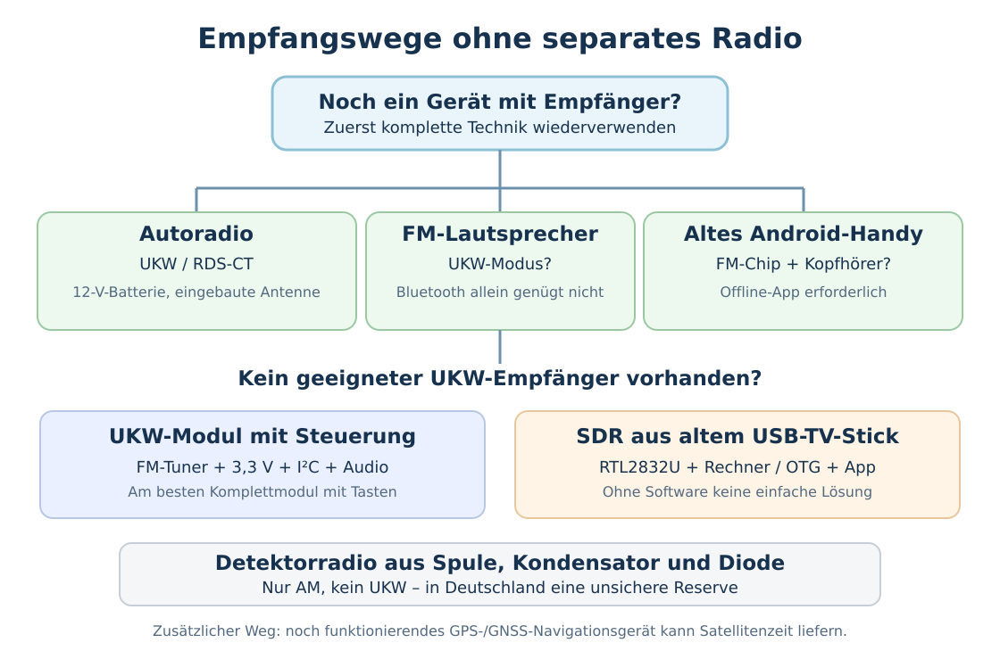

# Funkempfang ohne Radio – Geräte zweckentfremden und Empfänger improvisieren

!!! warning "Quellenbasierter Entwurf – Nachbauten noch nicht erprobt"
    Diese Anleitung unterscheidet zwischen **sofort einsatzfähigen Altgeräten**, **empfangsfähigen Baugruppen** und **echtem Neubau**. Baugruppen und Anschlüsse sind modellabhängig. Elektrische Schaltungen und Fundstücke müssen vor dem Einsatz geprüft werden; keine Netzspannungsbastelei. Stand: 26.10.2026.

## Ausgangslage

Ein Haushalt hat möglicherweise **kein separates Radio und kein Funkgerät**. Ein Mobiltelefon mit Internet-Radio-App hilft nicht, wenn das Netz ausgefallen ist. Gesucht ist ein Empfangsweg für Nachrichten, [hörbare Zeitzeichen](../04-kommunikation/zeitzeichen-rundfunk.md) und möglichst eine [synchronisierte Uhr für die 3-3-3-Regel](../04-kommunikation/funkzeitfenster-333-regel.md).

**Wichtig:** Man muss das Funksignal **demodulieren** können. Eine zufällige Spule und eine Diode genügen nicht, um ein UKW-Rundfunkprogramm bei rund **100 MHz (FM)** zu hören. Ein einfacher Detektorempfänger arbeitet mit **AM** auf Mittel- oder Langwelle, für die Deutschland die regulären öffentlichen Rundfunksender 2014/2015 weitgehend abgeschaltet hat.

{ width=100% }

## Vorhandene Geräte: von einfach bis aufwendig

| Fundstück aus eigenem Bestand oder mit Erlaubnis | Benötigt | Was ist realistisch? |
| --- | --- | --- |
| **Autoradio im Fahrzeug** | Intakte 12-V-Fahrzeugelektrik und Empfangsantenne | Oft schnellster vollständiger UKW-Empfänger; manche Modelle synchronisieren ihre Uhr per **RDS-CT** |
| **Bluetooth-Partybox, tragbarer Lautsprecher oder MP3-Spieler mit „FM“** | Passender Akku bzw. USB-Versorgung, ggf. Kabel als Antenne | Viele Modelle haben einen normalen UKW-Radiomodus, **aber nicht alle** |
| **Älteres Android-Telefon mit echtem FM-Tuner** | Vorinstallierte/kompatible **Offline-UKW-App**, bei manchen Modellen kabelgebundene Kopfhörer als Antenne | Empfängt ohne Mobilfunk/Internet; **aktuelles Android/iPhone nicht pauschal dafür geeignet** |
| **Handradio-/Wecker-/Küchenradio-Elektronik aus einem defekten Gerät** | Originale Abstimm-, Versorgungs- und Audioplatine möglichst komplett retten | Leichter als einzelne HF-Bausteine neu verschalten |
| **USB-DVB-T-Empfänger mit RTL2832U** | Kompatibler USB-Stick, Antenne, Laptop oder OTG-fähiges Android-Gerät und **bereits vorhandene** SDR-Software | Kann UKW als **Software Defined Radio** hören; nicht jeder DVB-T-Stick ist SDR-fähig |
| **RDA5807M-UKW-Modul** | 3,3-V-taugliche Versorgung, **I²C-Steuerung über Mikrocontroller**, Antenne, Kopfhörer/Verstärker | Relativ kompakter Neuaufbau; **reines Tunermodul nicht durch Stromanschluss allein bedienbar** |
| **AM-Detektorradio aus Einzelteilen** | Drahtspule, Dreh-/Festkondensator, geeignete Diode, sehr empfindlicher Ohrhörer, Antenne | Ohne Batterie möglich, aber **kein UKW** und in Deutschland nur mit ausreichenden ausländischen AM-Signalen |

**Keine Märchenlösung:** Das UKW-Signal wird nicht einfach durch Anschluss eines gewöhnlichen Ohrhörers an einen Draht hörbar.

## Sofortlösung A: Autoradio benutzen

1. Ein noch funktionsfähiges **Fahrzeugradio im eingebauten Zustand** verwenden; am sichersten das Fahrzeug auf Zubehör-/Radiobetrieb schalten, ohne den Motor laufen zu lassen.
2. **UKW / FM** wählen, empfangbare Nachrichtenprogramme suchen und nach einem **RDS / CT / Clock Time / Auto Clock**-Menü sehen. **Nicht jedes Autoradio unterstützt CT.**
3. Falls ein Sender CT sendet, eine Weile abwarten und angezeigte **Uhrzeit und Datum** ablesen. Gegen andere Quellen vergleichen: Sender können fehlerhafte Zeit und Sommerzeitversatz liefern.
4. Das Radio wieder ausschalten und die **12-V-Starterbatterie schonen**. Für kurze Uhrabgleiche nicht den Motor unnötig laufen lassen.

**Ausbau nur bei nachweislich passender Belegung:** Ältere Radios benötigen oft Dauerplus, geschaltetes Plus und Masse; viele neuere Geräte sind außerdem auf **CAN-Bus-Signale, Entsperrcode oder fahrzeugspezifische Verkabelung** angewiesen. **Pinbelegung nie allein nach Kabelfarbe raten.** Für Versuche ausschließlich **abgesicherte, passende 12-V-Niedervoltversorgung** und die Dokumentation des konkreten Modells verwenden. Keine offenen Leitungen an einer Autobatterie.

### Was ist RDS-CT?

**RDS – Clock Time** ist eine Zusatzinformation im normalen analogen UKW-Rundfunk. Ein geeignetes Radiogerät dekodiert diese **automatisch**, zeigt die Zeit an und kann seine eingebaute Quarzuhr danach nachstellen. RDS-CT wird **nur von manchen Sendern übertragen**, typischerweise mit einer **Minuteninformation im Abstand von etwa 60 Sekunden**. Es ist **keine garantierte, amtliche Sekundensynchronisation**: Sendeanlage, Zeitzonenoffset und RDS-Daten können falsch sein.

## Sofortlösung B: Lautsprecher oder altes Handy als UKW-Empfänger

1. Auf Gehäuse, Bedienungsanleitung oder Modusschalter nach **„FM“, „Radio“, „87.5–108 MHz“** suchen. Der Aufdruck **„Bluetooth“ allein** genügt nicht.
2. Bei manchen Lautsprechern durch **MODE**-Taste zwischen Bluetooth / USB / FM wechseln; Sendersuchlauf über Play- oder Vor-/Zurück-Tasten. Modellabhängig.
3. Bei einem älteren Android-Gerät gezielt die **bereits installierte UKW-/FM-App** öffnen. Oft ist ein kabelgebundenes Headset als Antenne notwendig. **Eine Streaming-App empfängt nicht ohne Internet**.
4. Bei Akkubetrieb ein Ladegerät oder eine Powerbank vorhalten. Im Krisenfall unnötige Displaybeleuchtung und Dauerempfang vermeiden.

Das ist keine Garantie, dass eine zufällige Bluetooth-Box Radio kann. **Funktion vor der Krise prüfen und kennzeichnen.**

## Aufbau C: Defektes Empfangsgerät retten

**Ziel:** Nicht eine neue Hochfrequenzschaltung entwickeln, sondern eine noch arbeitende Empfängerbaugruppe möglichst **vollständig** ausbauen.

1. Nach einer defekten Bluetooth-Box, einem alten MP3-Spieler mit FM, einem Funkwecker mit **separatem UKW-Tuner** oder einem Spielzeug-/Bausatzradio suchen.
2. **Vor dem Ausbau** Betriebsspannung, Anschlüsse, Antenne, Tasten, Lautsprecher und eventuelle Displayplatine fotografieren und beschriften. Die **Steuerplatine bei digital abstimmbaren Tunern** mitretten.
3. Gerät nur **spannungslos** öffnen. Eingebaute Li-Ion-Zellen nicht kurzschließen, durchstechen, erhitzen oder unbeaufsichtigt laden. **Netzbetriebene Geräte ohne elektrotechnische Fachkenntnis nicht an offenen Netzteilen betreiben.**
4. Möglichst die **originale Niedervoltversorgung** und einen kompletten Tuner-Audio-Verbund wiederherstellen, statt unbekannte Kontakte durch Ausprobieren zu bestromen. Wo das nicht möglich ist: kein blindes Anschließen.

## Aufbau D: Einfacher UKW-Empfänger aus Modul und vorhandener Elektronik

Es gibt zwei wesentlich unterschiedliche Baugruppen:

- **Komplettmodul bzw. UKW-Bausatz mit Suchlauf-Tasten, Steuerelektronik und Audioausgang:** Am einfachsten. **Genau die auf dem Modul angegebene** Batteriespannung/USB-Spannung verwenden, passende Antenne (für ca. 100 MHz z. B. **ungefähr 75 cm Draht**) an den **dafür vorgesehenen Antennenanschluss** und geeigneten Kopfhörer/Lautsprecher an den Ausgang.
- **Nur der winzige Tuner-Baustein RDA5807M:** Muss normalerweise per **I²C** von einem Mikrocontroller (beispielsweise 3,3-V-ESP32) initialisiert, abgestimmt und in der Lautstärke gesteuert werden. Benötigt zudem geregelte Versorgung und passende Audioanbindung; **keine direkte 5-V-Speisung eines nackten 3,3-V-Breakoutboards oder seiner I²C-Pins**.

### Funktionsblock für ein RDA5807M-Modul

```text
   70–80 cm Draht (UKW-Antenne)
                │
         [FM-ANT am Modul]
                │
         ┌──────────────┐      I²C (SDA/SCL, 3,3-V-Pegel)
         │ RDA5807M     │ ◀─────────────────────────┐
         │ UKW-Tuner    │                           │
         └─────┬────────┘                    [ESP32 / passende
             LOUT/ROUT                       Steuerplatine]
                │                                  │
        [Kopfhörer / geeigneter           [Batterie + passende
         Audioverstärker]                  geregelte Versorgung]
```

- **GND muss gemeinsam** sein, Versorgung und I²C-Logik müssen die **Spezifikation des konkreten Moduls** erfüllen. Manche Trägerplatinen besitzen Regler, andere nicht.
- Den Ausgang **LOUT/ROUT nicht unmittelbar an einen passiven Lautsprecher** hängen; je nach Modul sind Koppelkondensatoren und ein Verstärker notwendig.
- Ein **Tastensuchlauf-Modul** ist im Krisenfall erheblich praktischer als ein nackter RDA5807M, denn Firmware und Treiber werden im Zweifel nicht mehr verfügbar sein.
- Der RDA5807-Bauweg wurde **für diesen Leitfaden noch nicht erprobt**; die schematische Zeichnung ist **keine geprüfte Pin-für-Pin-Bauanleitung**.

**Alternative mit Computer:** Ein vorhandener **RTL2832U-kompatibler DVB-T-USB-Stick**, passende Antenne und **vorinstallierte** SDR-Software wie SDR Touch können analoges UKW demodulieren. Ein normaler TV-Stick **ohne** unterstützten SDR-Chipsatz kann das nicht ohne Weiteres. Der dafür laufende Computer benötigt erheblich mehr Energie als ein kleines Radiomodul.

## Aufbau E: Detektorradio – wirklich mit einfachsten Mitteln, aber nur für AM

Eine klassische **Kristall-/Detektorschaltung** benötigt **keine Stromversorgung**. Sie ist ein sinnvoller Lehr- und Langzeit-Wiederaufbau, aber **keine zuverlässige Lösung für deutsche UKW-Zeitzeichen**.

**Material:** ungefähr 100 Windungen isolierter Kupferlackdraht um eine Papprolle als Versuchsspule; idealerweise ein aus einem alten AM-Radio geretteter **Drehkondensator** (ungefähr 150–500 pF); **Germanium- oder Schottkydiode** (z. B. 1N34, OA90, BAT85); **hochohmiger Kristallohrhörer** oder Kopfhörer mit Anpassübertrager; isolierter Antennendraht und sichere Erdverbindung. **Normale 32-Ω-Kopfhörer funktionieren direkt oft nicht.**

```text
    isolierte Drahtantenne
             │
             ├───────o────>|────[Kristallohrhörer]─────┐
             │         Diode                           │
          [Spule]                                       │
             │                                         │
             ├───────────────[Drehkondensator]──────────┤
             │                                         │
       Erdanschluss ────────────────────────────────────┘
```

Dies ist das **grundlegende Funktionsprinzip eines parallel abgestimmten Schwingkreises**, **kein fertiger, auf eine Frequenz abgestimmter Versuchsbau**. Spulenabgriff und Antennenkopplung können für brauchbaren Empfang angepasst werden müssen.

1. Spule wickeln; Windungen sauber nebeneinander und Lack an vorgesehenen Kontakten entfernen. Für den Anfang einige **Abgriffe** vorsehen.
2. Spule und veränderbaren Kondensator **parallel** verbinden; mit der Diode die schwache AM-Modulation gleichrichten und über den hochohmigen Ohrhörer hören.
3. Eine **ausreichend lange, isolierte Antenne** fern von Freileitungen verwenden; niemals während Gewitter und **niemals Netzsteckdosen oder Schutzleiter als Erdung missbrauchen**.
4. Durch Verändern von Kapazität und Spulenabgriff einen **starken AM-Sender** suchen. Wegen fehlender deutschen MW-/LW-Sender gegebenenfalls nachts ausländische AM-Stationen; **kein Empfang garantiert**.

Die populäre Vorstellung, dass **„eine Spule plus Diode“** automatisch alle Funkwellen hörbar macht, ist falsch: **UKW-FM erfordert einen anderen Empfängertyp.**

## Vielleicht noch einfacher als Radio: Satellitenuhr

Ein noch lauffähiges **altes Navigationsgerät oder Smartphone mit GNSS/GPS-Empfänger** kann **Satellitenzeitsignale ohne Internet, SIM oder Mobilfunknetz** empfangen, sofern das Satellitensystem und das Gerät funktionieren. Je nach Gerät braucht es freie Sicht zum Himmel, eine gespeicherte Karte oder ein geeignetes **offline installiertes Diagnoseprogramm**, das UTC anzeigt.

**Achtung:** Nicht jedes Telefon stellt seine **Systemuhr automatisch aus GNSS**. Bei Android ist GNSS-Zeitsynchronisation geräteabhängig und in der Standardkonfiguration **nicht generell aktiviert**. Geräteanzeige nach Satellitenfix prüfen; für deutsche Zeit **UTC + 1 Stunde (MEZ) bzw. + 2 Stunden (MESZ)**. Alte Navigationsgeräte können Datum/Zeit durch Firmwarefehler falsch anzeigen.

Für eine zuverlässige **3-3-3-Koordinierung** reicht ein einmaliger Zeitabgleich nicht: Eine **laufende, energiesparende Quarzuhr** zum Überbrücken der nächsten Stunden ist weiterhin wichtig.

## Priorität im echten Katastrophenfall

1. **Uhr retten:** Batterie-Quarzuhr, Armbanduhr oder anderes Gerät, das selbstständig weiterläuft.
2. **Funksignal mit fertiger vorhandener Technik empfangen:** Autoradio, FM-Lautsprecher, älteres Handy, Funkuhr; RDS-CT und akustische Ansage vergleichen.
3. **Satellitenzeit** über vorhandenes GPS-/GNSS-Gerät versuchen.
4. **Noch brauchbare Empfangsbaugruppe** aus Altgeräten mit intakter Steuerung und Versorgung retten.
5. **Einfachen UKW-Tuner** aus Komplettmodul oder RDA5807M und Steuerplatine aufbauen.
6. **Detektorradio/individuelle HF-Schaltung** nur als experimentelle Notlösung und Lernprojekt.

**Beschaffung und Zugang:** Zuerst eigenes Eigentum, vorher angelegte Ersatzteile und freiwillig geteilte Geräte aus Nachbarschaft, Werkstätten, Autowerkstätten, Reparaturcafés und Elektronik-Altgerätesammlungen. Nicht von der Annahme ausgehen, dass andere Eigentümer oder Geschäfte im Krisenfall frei zugängliche Materiallager sind.

## Praktischer Vorabtest

- Vorhandene alte Bluetooth-Box auf **FM-Modus** prüfen; Funktion ohne WLAN/Mobilfunk testen.
- Autoradio auf **RDS-CT** prüfen, gegen zuverlässig gestellte Uhr vergleichen und Stromaufnahme/12-V-Batterierisiko beachten.
- Vorhandenes GPS-Gerät ohne mobile Daten benutzen und prüfen, **ob tatsächlich UTC nach Satellitenfix** ablesbar ist.
- Einen vorhandenen 3,3-V-Tuner **mit dokumentiertem Datenblatt und passendem Mikrocontroller** testen und Stromverbrauch protokollieren.
- **Eigene Ergebnisse** und Abweichungen dokumentieren. **Kein in diesem Artikel beschriebener improvisierter Nachbau wurde bislang redaktionell praktisch validiert.**

## Quellen

- [The Open University: Building a crystal radio set](https://www.open.edu/openlearn/science-maths-technology/science/physics-and-astronomy/physics/building-crystal-radio-set) – AM-Detektorradio, Schwingkreis, geeignete Dioden und Kopfhörer, sichere Antenne.
- [Deutschlandradio: Geschichte](https://www.deutschlandradio.de/geschichte-144.html) und [Deutschlandfunk: Ende der Mittelwelle](https://www.deutschlandfunk.de/ende-der-mittelwelle-der-schritt-ist-unerlaesslich-100.html) – Abschaltung des deutschen Lang-/Mittelwellenrundfunks 2014/2015.
- [RDS Forum: RDS eBook, Clock Time and Date](https://www.rdsforum.org/2010/pdf/RDS_ebook_9782940536207.pdf) – CT-Zeit und Datum im RDS-Zusatzkanal.
- [Gira: Warum zeigt das Radio eine falsche oder keine Uhrzeit?](https://www.app.gira.de/service/faq/antwort.html?id=1741) – Fehlzeiten und nicht von allen Stationen gesendete CT-Daten.
- [teltarif.de: Warum Smartphones kaum noch UKW-Radio haben](https://www.teltarif.de/smartphone-radio-ukw-dabplus/news/105721.html), 30.08.2026 – ältere Smartphones, Kopfhörerantenne und moderne Einschränkungen.
- [Karcher PS 4460](https://www.karcher-audio.de/index.php/produktdetails/ps-4460.html) – Herstellerbeispiel Bluetooth-Box mit UKW-Tuner.
- [RDA5807: Arduino-Library und Pegelwarnungen](https://github.com/pu2clr/RDA5807) sowie [RDA5807M-Datenblatt](https://datasheet.lcsc.com/lcsc/RDA5807M_C82537.pdf) – I²C-Steuerung und Versorgung.
- [SDR Touch – unterstützte Empfänger](https://sdrtouch.com/) – kompatible RTL2832U-USB-DVB-T-Empfänger und Android-OTG.
- [GPS.gov: GPS and Telling Time](https://www.gps.gov/gps-and-telling-time) – Satellitenzeitsignal.
- [Android Open Source Project: GNSS Time Detection](https://source.android.com/docs/core/connect/time/gnss-time-detection) – optionale statt generell aktivierte GNSS-Uhrensynchronisation.

**Status:** Quellenbasierter Entwurf; Fachprüfung und Feldversuche fehlen.
